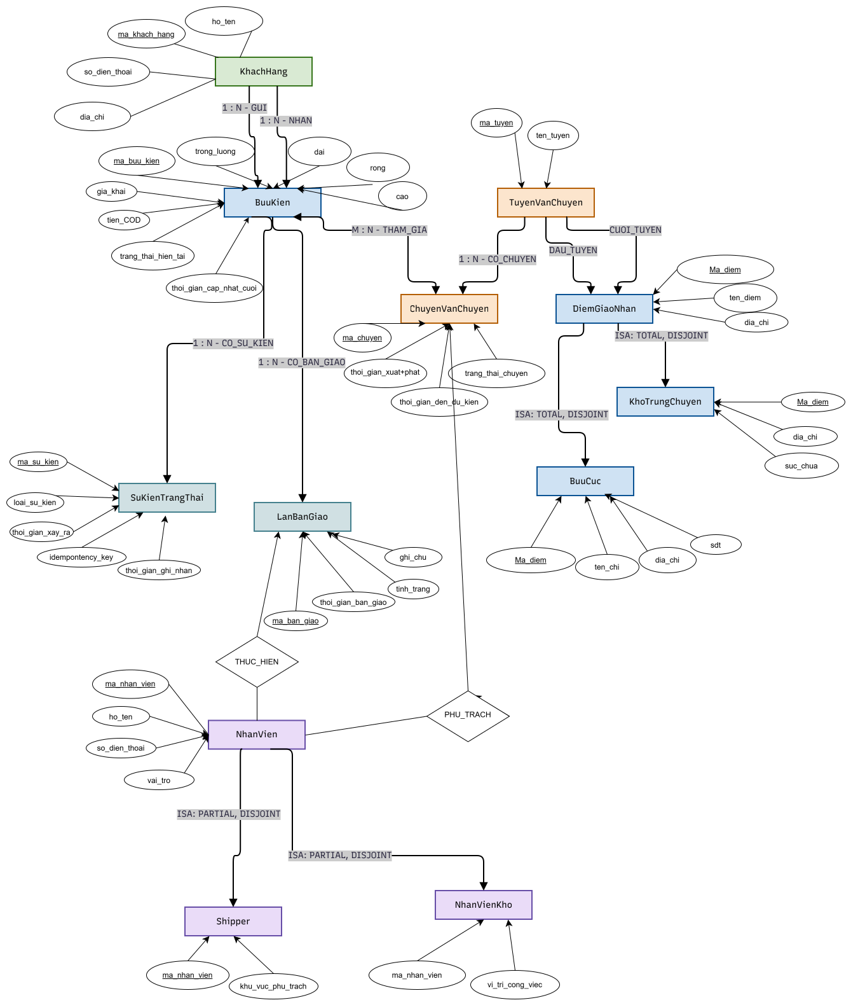

  
  
  

# Đồ án môn học: Cơ Sở Dữ Liệu Nâng Cao (Advanced Databases)
**Chủ đề: Đề tài 13 - Thiết kế Cơ Sở Dữ Liệu theo dõi vận chuyển và bàn giao bưu kiện**

**Nhóm thực hiện:**
- Lê Thị Khánh Linh - 3124410187
- Nguyễn Thị loan - 3124410191
- Phạm Hữu Phú Khánh - 3124410152
- Đoàn Quang Khải - 3124410138

## 1. Giới thiệu đề tài (Mục tiêu và Phạm vi)
- **Mục tiêu:** Quản lý hành trình bưu kiện qua các điểm trung chuyển, lưu lịch sử bàn giao và xác định trạng thái hiện tại nhất quán.
- **Câu hỏi nghiên cứu:** Nên tính trạng thái hiện tại từ lịch sử hay lưu riêng? Làm thế nào xử lý sự kiện gửi trùng, đến muộn và cập nhật đồng thời?
- **Phạm vi dữ liệu:** Bưu kiện, người gửi/nhận, bưu cục, điểm trung chuyển, tuyến, chuyến vận chuyển, nhân viên, lần bàn giao và sự kiện trạng thái.
## 2. Sơ đồ Kiến trúc và Dòng chảy Hoạt động (Workflow)

Dự án kết hợp **Docker**, **PostgreSQL** và **Python**. Docker dựng CSDL tự động, SQL định nghĩa lược đồ, truy vấn và transaction, còn Python sinh dữ liệu, kiểm thử đồng thời và đo hiệu năng.

```mermaid
graph TD
    subgraph GD1 ["Giai đoạn 1: Dựng hạ tầng và CSDL tự động (Docker và SQL)"]
        ENV[".env<br/>(user, password, database, port)"] --> DC["docker-compose.yml"]
        DC -->|1. Khởi tạo container postgres:18| PG[("PostgreSQL: parcel<br/>volume pgdata")]
        S1["01_schema.sql<br/>• Bảng, khóa, ràng buộc<br/>• Bảng luật chuyển trạng thái"] -->|2. Tự chạy lần khởi tạo đầu| PG
        S2["02_seed.sql (dự kiến)<br/>• Dữ liệu mẫu nhỏ, cố định"] -->|3. Nạp dữ liệu mẫu| PG
        S5["05_handover_tx.sql (dự kiến)<br/>• Hàm ghi sự kiện và bàn giao<br/>• Chống trùng, xử lý đến muộn"] -->|4. Nạp hàm nguyên tử| PG
    end

    subgraph GD2 ["Giai đoạn 2: Sinh dữ liệu và kiểm thử (Python, dự kiến)"]
        GEN["gen_events.py<br/>• Đúng thứ tự, đến muộn, gửi trùng<br/>• Sinh kèm đáp án kỳ vọng"] -->|Gọi hàm ghi sự kiện| PG
        CON["test_concurrency.py<br/>• 2 nhân viên bàn giao cùng bưu kiện<br/>• Gửi lại cùng event_id"] -->|Nhiều kết nối đồng thời| PG
    end

    subgraph GD3 ["Giai đoạn 3: Truy vấn và phân tích (SQL, dự kiến)"]
        Q1["03_queries.sql<br/>• Hành trình, thời gian lưu tại điểm<br/>• Bưu kiện chậm, tỷ lệ giao thành công"]
        Q2["04_recursive.sql<br/>• WITH RECURSIVE: các điểm có thể đến<br/>• Chặn chu trình"]
        Q3["06_indexes_explain.sql<br/>• Chỉ mục và EXPLAIN ANALYZE"]
        BEN["benchmark.py<br/>• So sánh phương án A và B"]
        Q1 --> PG
        Q2 --> PG
        Q3 --> PG
        BEN --> PG
    end

    OQL["Mô hình đối tượng SuKienVanChuyen<br/>(lớp con và truy vấn OQL)"] -.->|Đối chiếu mô hình| PG

    classDef db fill:#316192,stroke:#fff,stroke-width:2px,color:#fff;
    classDef py fill:#3776AB,stroke:#fff,stroke-width:1.5px,color:#fff;
    classDef sql fill:#7B4FA3,stroke:#fff,stroke-width:1.5px,color:#fff;
    classDef cfg fill:#607D8B,stroke:#fff,stroke-width:1.5px,color:#fff;
    classDef doc fill:#4CAF50,stroke:#fff,stroke-width:1.5px,color:#fff;
    class PG db;
    class GEN,CON,BEN py;
    class S1,S2,S5,Q1,Q2,Q3 sql;
    class ENV,DC cfg;
    class OQL doc;
```

## 3. Sơ đồ thực thể EER

## 4. Tài liệu tham khảo
1. **PostgreSQL – WITH và Recursive Queries**
2. **PostgreSQL – Transaction Isolation**
3. **PostgreSQL – Using EXPLAIN**