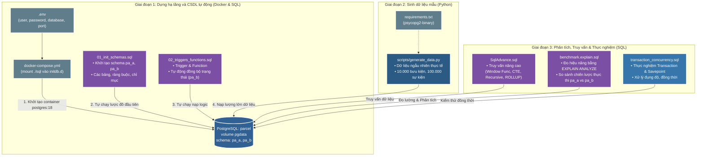

  
  
  

# Đồ án môn học: Cơ Sở Dữ Liệu Nâng Cao (Advanced Databases)
**Chủ đề: Đề tài 13 - Thiết kế Cơ Sở Dữ Liệu theo dõi vận chuyển và bàn giao bưu kiện**

**Nhóm thực hiện:**
- Lê Thị Khánh Linh - 3124410187
- Nguyễn Thị Loan - 3124410191
- Phạm Hữu Phú Khánh - 3124410152
- Đoàn Quang Khải - 3124410138

## 1. Giới thiệu đề tài (Mục tiêu và Phạm vi)
- **Mục tiêu:** Quản lý hành trình bưu kiện qua các điểm trung chuyển, lưu lịch sử bàn giao và xác định trạng thái hiện tại nhất quán.
- **Câu hỏi nghiên cứu:** Nên tính trạng thái hiện tại từ lịch sử hay lưu riêng? Làm thế nào xử lý sự kiện gửi trùng, đến muộn và cập nhật đồng thời?
- **Phạm vi dữ liệu:** Bưu kiện, người gửi/nhận, bưu cục, điểm trung chuyển, tuyến, chuyến vận chuyển, nhân viên, lần bàn giao và sự kiện trạng thái.

## 2. Sơ đồ Kiến trúc và Dòng chảy Hoạt động (Workflow)
Dự án kết hợp **Docker**, **PostgreSQL** và **Python** với luồng hoạt động được chia làm 3 giai đoạn rõ rệt:

- Hạ tầng & Cấu trúc: Docker khởi tạo CSDL tự động; các script SQL thiết lập lược đồ đối sánh (schema pa_a và pa_b) cùng hệ thống Trigger/Function xử lý logic nghiệp vụ.

- Dữ liệu mẫu (Seeding): Script Python đảm nhiệm việc sinh tự động khối lượng lớn dữ liệu thử nghiệm (hàng chục ngàn sự kiện) mô phỏng thực tế.

- Đánh giá & Phân tích: Các kịch bản chuyên sâu được thiết lập độc lập để thực hiện truy vấn phức tạp (SQL Advance), phân tích hiệu năng (EXPLAIN ANALYZE) và thực nghiệm xử lý đụng độ giao dịch (Transaction Concurrency).

## 3. Sơ đồ thực thể EER

## 4. Cấu trúc Mã nguồn Dự án

Dự án đã được tái cấu trúc để phân tách rõ ràng giữa hạ tầng CSDL, script sinh dữ liệu và các truy vấn phục vụ môn học:

- `sql/01_init_schemas.sql`: Khởi tạo 2 schema `pa_a` (History-based) và `pa_b` (Current State) cùng các bảng, ràng buộc và chỉ mục.
- `sql/02_triggers_functions.sql`: Trigger và Function tự động đồng bộ trạng thái hiện tại cho `pa_b`.
- `sql/SqlAdvance.sql`: 5 câu truy vấn SQL nâng cao (Window Functions, CTE, Recursive CTE, ROLLUP).
- `sql/benchmark.explain.sql`: Kịch bản đo hiệu năng đối sánh `pa_a` và `pa_b` (`EXPLAIN ANALYZE`).
- `sql/transaction_concurrency.sql`: Kịch bản thực nghiệm giao dịch (Transaction, Savepoint) và xử lý đồng thời.
- `scripts/generate_data.py`: Script Python sinh dữ liệu mẫu (10.000 bưu kiện & 100.000 sự kiện).
- `requirements.txt`: Thư viện Python cần thiết (`psycopg2-binary`).

## 5. Hai phương án kiến trúc CSDL

| Tiêu chí | `pa_a` (History-based) | `pa_b` (Current State) |
|---|------------------------|------------------------|
| **Nơi lưu trạng thái hiện tại** | Không lưu; **tính khi đọc** từ sự kiện mới nhất | Cột `trang_thai_hien_tai` trên bảng bưu kiện |
| **Hàm `ghi_su_kien()`** | Chỉ `INSERT` sự kiện | `INSERT` sự kiện, rồi `UPDATE` trạng thái nếu sự kiện này mới hơn |
| **Gửi trùng** | `idempotency_key` có `UNIQUE`, `ON CONFLICT DO NOTHING` | Giống `pa_a`, và không đụng tới trạng thái |
| **Đến muộn** | Tự đúng vì trạng thái là sự kiện có `(thoi_gian_xay_ra, ma_su_kien)` lớn nhất | `UPDATE` có điều kiện "mới hơn sự kiện đang áp dụng" |

## 6. Hướng dẫn cài đặt và chạy

Để giữ cho tài liệu gọn gàng, toàn bộ hướng dẫn khởi tạo môi trường (Docker), sinh dữ liệu (Python) và chạy kịch bản đã được chuyển sang các tài liệu chuyên biệt.

Vui lòng xem chi tiết từng bước tại:
👉 **[Hướng dẫn cài đặt và chạy dự án](docs/huong-dan-cai-dat-va-chay.md)**
👉 **[Hướng dẫn thiết lập PostgreSQL](docs/setup-postgresql.md)**