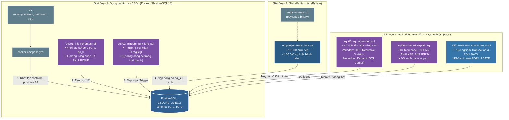
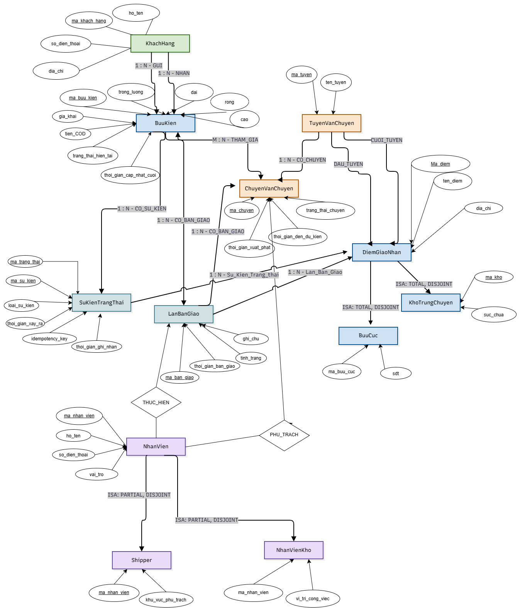

  
  
  

# Đồ án môn học: Cơ Sở Dữ Liệu Nâng Cao (Advanced Databases)
**Chủ đề: Đề tài 13 – Thiết kế Cơ sở dữ liệu theo dõi vận chuyển và bàn giao bưu kiện**

**Nhóm thực hiện (Nhóm 13):**
- Đoàn Quang Khải – `3124410138`
- Lê Thị Khánh Linh – `3124410187`
- Nguyễn Thị Loan – `3124410191`
- Phạm Hữu Phú Khánh – `3124410152`

---

## 1. Giới thiệu Đề tài (Mục tiêu và Phạm vi)
- **Mục tiêu:** Quản lý hành trình bưu kiện qua các điểm trung chuyển, lưu lịch sử bàn giao và xác định trạng thái hiện tại nhất quán.
- **Câu hỏi nghiên cứu:** Nên tính trạng thái hiện tại từ lịch sử (`pa_a` – History-based) hay lưu riêng (`pa_b` – Current-state)? Làm thế nào xử lý sự kiện gửi trùng (`BR-07`), đến muộn (`BR-06`) và cập nhật đồng thời?
- **Phạm vi dữ liệu:** Bưu kiện, khách hàng gửi/nhận, điểm giao nhận (bưu cục, kho trung chuyển), tuyến, chuyến vận chuyển, chi tiết chuyến, nhân viên (shipper, nhân viên kho), phụ trách, lần bàn giao và sự kiện trạng thái.

---

## 2. Sơ đồ Kiến trúc và Dòng chảy Hoạt động (Workflow)

Dự án kết hợp **Docker**, **PostgreSQL 18** và **Python** với luồng hoạt động 3 giai đoạn:
1. **Hạ tầng & Cấu trúc (Giai đoạn 1):** Khởi tạo CSDL, thiết lập 2 schema đối sánh (`pa_a` và `pa_b`) cùng Trigger/Function xử lý logic nghiệp vụ.
2. **Dữ liệu mẫu – Seeding (Giai đoạn 2):** Script Python sinh tự động **10.000 bưu kiện** và **100.000 sự kiện trạng thái** đồng bộ trên cả 2 schema.
3. **Đánh giá & Phân tích (Giai đoạn 3):** Thực thi bộ 12 câu truy vấn & thủ tục SQL nâng cao, đo hiệu năng bằng `EXPLAIN (ANALYZE, BUFFERS)` và kiểm thử giao dịch đồng thời (`SELECT ... FOR UPDATE`, `ROLLBACK`).

---

## 3. Sơ đồ Thực thể – Kết hợp Mở rộng (EER)

---

## 4. Cấu trúc Thư mục và Tài liệu Dự án

### 4.1. Mã nguồn SQL & Script (`sql/`, `scripts/`)
- [`sql/01_init_schemas.sql`](sql/01_init_schemas.sql): Khởi tạo 2 schema `pa_a` (History-based / BCNF) và `pa_b` (Current-state) cùng toàn bộ các bảng và ràng buộc.
- [`sql/02_triggers_functions.sql`](sql/02_triggers_functions.sql): Trigger `trg_cap_nhat_trang_thai` và Function PL/pgSQL xử lý sự kiện đến muộn & tự động đồng bộ trạng thái cho `pa_b`.
- [`sql/05_sql_advanced.sql`](sql/05_sql_advanced.sql): Bộ 12 câu truy vấn & thủ tục SQL nâng cao (Window Functions, CTE, `WITH RECURSIVE`, `ROLLUP`, Correlated Subquery, Relational Division, Stored Procedure, Dynamic SQL chống SQL Injection, Cursor).
- [`sql/benchmark.explain.sql`](sql/benchmark.explain.sql): Kịch bản đo hiệu năng đối sánh `pa_a` và `pa_b` bằng `EXPLAIN (ANALYZE, BUFFERS)`.
- [`sql/transaction_concurrency.sql`](sql/transaction_concurrency.sql): Kịch bản thực nghiệm giao dịch (`ROLLBACK` khi lỗi FK) và xử lý đồng thời (`SELECT ... FOR UPDATE` chống Lost Update).
- [`scripts/generate_data.py`](scripts/generate_data.py): Script Python sinh dữ liệu mẫu (10.000 bưu kiện & 100.000 sự kiện).

### 4.2. Bộ Tài liệu Chuyên sâu & Báo cáo (`docs/`, `reports/`)
- [`docs/01-Vong-doi-buu-kien.md`](docs/01-Vong-doi-buu-kien.md): Quy trình vận chuyển 5 giai đoạn, 7 quy tắc nghiệp vụ (`BR-01` $\rightarrow$ `BR-07`) và Ma trận chuyển đổi trạng thái hợp lệ (State Transition Matrix).
- [`docs/02-eer-chuan-hoa.md`](docs/02-eer-chuan-hoa.md): Thiết kế EER, Từ điển dữ liệu, chiến lược ánh xạ kế thừa và Phân tích chuẩn hóa BCNF / 4NF (17 phụ thuộc hàm, bao đóng $X^+$, phủ tối tiểu $F_c$, Lossless Join).
- [`docs/03-thiet-ke-lich-su.md`](docs/03-thiet-ke-lich-su.md): Thiết kế lịch sử dữ liệu (*Event Time* vs *Ingest Time*), kiến trúc `pa_a` vs `pa_b`, chỉ mục B-Tree và phân vùng bảng vật lý (Range Partitioning).
- [`docs/04-quy-tac-su-kien-den-muon.md`](docs/04-quy-tac-su-kien-den-muon.md): Quy tắc xử lý sự kiện đến muộn (`BR-06`), chống gửi trùng (`BR-07` – Idempotency Key) và giao dịch bàn giao nguyên tử.
- [`docs/05-so-sanh-hai-phuong-an.md`](docs/05-so-sanh-hai-phuong-an.md): Kết quả thực nghiệm đối sánh hiệu năng `pa_a` vs `pa_b` (`EXPLAIN ANALYZE`) và kiểm thử giao dịch đồng thời.
- [`docs/06-mo-hinh-doi-tuong-oql.md`](docs/06-mo-hinh-doi-tuong-oql.md): Thiết kế CSDL hướng đối tượng (UML Class Diagram, đặc tả ODL ODMG 3.0) và 5 câu truy vấn OQL ánh xạ sang SQL.
- [`reports/Báo cáo CSDL Nâng cao - Nhóm 13 - Đề tài 13 (Hoàn chỉnh).docx`](reports/Báo%20cáo%20CSDL%20Nâng%20cao%20-%20Nhóm%2013%20-%20Đề%20tài%2013%20(Hoàn%20chỉnh).docx): Bản báo cáo toàn văn hoàn chỉnh của nhóm.

---

## 5. Tóm tắt Đối sánh Hai Phương án Kiến trúc (`PA_A` vs `PA_B`)

| Tiêu chí | Phương án A (`pa_a` – History-based) | Phương án B (`pa_b` – Current-state) |
| :--- | :--- | :--- |
| **Lưu trữ trạng thái hiện tại** | Không lưu trên `BuuKien`; **tính động khi đọc** từ sự kiện mới nhất | Lưu trực tiếp trên `BuuKien` (`trang_thai_hien_tai`, `thoi_gian_cap_nhat_cuoi`) |
| **Dạng chuẩn CSDL** | Đạt chuẩn **BCNF tuyệt đối** | Phi chuẩn hóa có kiểm soát, đồng bộ qua Trigger PL/pgSQL |
| **Xử lý gửi trùng (`BR-07`)** | `idempotency_key UNIQUE` + `ON CONFLICT DO NOTHING` | Giống `pa_a`, bỏ qua bản ghi trùng và không kích hoạt lại Trigger |
| **Xử lý đến muộn (`BR-06`)** | Tự động đúng khi sắp xếp theo `thoi_gian_xay_ra DESC` | Trigger chỉ `UPDATE` khi `NEW.thoi_gian_xay_ra >= thoi_gian_cap_nhat_cuoi` |
| **Tốc độ đọc 1 bưu kiện** | `14,664 ms` | **`0,058 ms` (Nhanh hơn ~252,83 lần)** |
| **Tốc độ đọc 10.000 bưu kiện** | `855,795 ms` | **`9,678 ms` (Nhanh hơn ~88,43 lần)** |
| **Tốc độ ghi 1 sự kiện (`INSERT`)** | **`0,462 ms` (Nhanh hơn ~272,84 lần)** | `126,050 ms` |

---

## 6. Hướng dẫn Cài đặt và Chạy Thực nghiệm

Xem hướng dẫn chi tiết từng bước tại: 👉 **[docs/huong-dan-cai-dat-va-chay.md](docs/huong-dan-cai-dat-va-chay.md)**
