<p align="center">
  
  
  
</p>

# Đồ án môn học: Cơ Sở Dữ Liệu Nâng Cao (Advanced Databases)
**Chủ đề: Đề tài 13 - Thiết kế Cơ Sở Dữ Liệu theo dõi vận chuyển và bàn giao bưu kiện**

**Nhóm thực hiện:**
- Lê Thị Khánh Linh - 3124410187
- Nguyễn Thị loan - 3124410191
- Phạm Hữu Phú Khánh - 3124410152
- Đoàn Quang Khải - 3124410138

## 1. Giới thiệu đề tài (Mục tiêu và Phạm vi)
- **Mục tiêu:** Quản lý hành trình bưu kiện qua các điểm trung chuyển, lưu lịch sử bàn giao và xác định trạng thái hiện tại nhất quán.
- **Câu hỏi nghiên cứu:** Nên tính trạng thái hiện tại từ lịch sử hay lưu riêng? Làm thế nào xử lý sự kiện gửi trùng, đến muộn và cập nhật đồng thời?
- **Phạm vi dữ liệu:** Bưu kiện, người gửi/nhận, bưu cục, điểm trung chuyển, tuyến, chuyến vận chuyển, nhân viên, lần bàn giao và sự kiện trạng thái.

## 2. Sơ đồ Kiến trúc và Dòng chảy Hoạt động (Workflow)
Dự án kết hợp **Docker** và **PostgreSQL**. Docker dựng CSDL tự động; SQL (cùng các hàm PL/pgSQL) định nghĩa lược đồ, ghi sự kiện, sinh dữ liệu thử và kiểm thử chức năng; **pgbench** kiểm thử ghi đồng thời. Hai phương án A và B nằm trong cùng một CSDL (schema `pa_a` và `pa_b`), dùng chung dữ liệu nền ở schema `core`. Các mục ghi "dự kiến" là phần nhóm sẽ làm tiếp.

```mermaid
graph TD
    subgraph GD1 ["Giai đoạn 1: Dựng hạ tầng và CSDL tự động (Docker và SQL)"]
        ENV[".env<br/>(user, password, database, port)"] --> DC["docker-compose.yml<br/>(mount ./sql vào initdb.d)"]
        DC -->|1. Khởi tạo container postgres:18| PG[("PostgreSQL: parcel<br/>volume pgdata<br/>schema: core, pa_a, pa_b")]
        S1["01_core.sql<br/>• Schema core: bảng dùng chung<br/>• Khách hàng, điểm giao nhận,<br/>nhân viên, tuyến, chuyến"] -->|2. Tự chạy lần khởi tạo đầu| PG
        S2["02_pa_a.sql (Phương án A: History-based)<br/>• Chỉ lưu lịch sử sự kiện<br/>• Trạng thái hiện tại tính từ lịch sử<br/>• Hàm ghi_su_kien: chống trùng"] -->|3. Dựng phương án A| PG
        S3["03_pa_b.sql (Phương án B: Current State)<br/>• Lưu sẵn trạng thái hiện tại<br/>• Hàm ghi_su_kien: chống trùng, xử lý đến muộn<br/>• View kiểm tra nhất quán"] -->|4. Dựng phương án B| PG
        S4["04_seed.sql<br/>• 10.000 bưu kiện, 100.000 sự kiện<br/>• Nạp giống nhau cho A và B"] -->|5. Nạp dữ liệu thử| PG
    end

    subgraph GD2 ["Giai đoạn 2: Kiểm thử chức năng và đồng thời (SQL và pgbench)"]
        TST["tests/test_su_kien.sql<br/>• Đúng thứ tự, gửi trùng, đến muộn<br/>• Trạng thái hiện tại của A và B phải khớp"] -->|Gọi ghi_su_kien trên A và B| PG
        BEN["scripts/bench_ghi_su_kien.sql (pgbench)<br/>• Nhiều client ghi cùng lúc<br/>• Gửi trùng, đến muộn, cập nhật đồng thời<br/>• Đo tps của A và B"] -->|Nhiều kết nối đồng thời| PG
    end

    subgraph GD3 ["Giai đoạn 3: Truy vấn và phân tích (SQL)"]
        VW["v_buu_kien_hien_tai (đã có)<br/>• A: tính từ sự kiện mới nhất<br/>• B: đọc cột lưu sẵn<br/>• So sánh bằng EXPLAIN ANALYZE"]
        Q1["05_queries.sql (dự kiến)<br/>• Hành trình, thời gian lưu tại điểm<br/>• Bưu kiện chậm, tỷ lệ giao thành công"]
        Q2["06_recursive.sql (dự kiến)<br/>• WITH RECURSIVE: các điểm có thể đến<br/>• Chặn chu trình"]
        Q3["07_indexes_explain.sql (dự kiến)<br/>• Chỉ mục và EXPLAIN ANALYZE"]
        VW --> PG
        Q1 --> PG
        Q2 --> PG
        Q3 --> PG
    end

    OQL["Mô hình đối tượng SuKienVanChuyen<br/>(docs/06: lớp con và truy vấn OQL)"] -.->|Đối chiếu mô hình| PG

    classDef db fill:#316192,stroke:#fff,stroke-width:2px,color:#fff;
    classDef test fill:#3776AB,stroke:#fff,stroke-width:1.5px,color:#fff;
    classDef sql fill:#7B4FA3,stroke:#fff,stroke-width:1.5px,color:#fff;
    classDef cfg fill:#607D8B,stroke:#fff,stroke-width:1.5px,color:#fff;
    classDef doc fill:#4CAF50,stroke:#fff,stroke-width:1.5px,color:#fff;
    class PG db;
    class TST,BEN test;
    class S1,S2,S3,S4,VW,Q1,Q2,Q3 sql;
    class ENV,DC cfg;
    class OQL doc;
```



## 3. Sơ đồ thực thể EER


## 4. Cấu trúc Mã nguồn Dự án

### 4.1. Cây thư mục

```text
CSDLNC-Nhom13-van-chuyen-buu-kien/
├── docker-compose.yml          # Dựng PostgreSQL 18; mount ./sql để tự chạy lần khởi tạo đầu
├── .env.example                # Mẫu cấu hình (user, mật khẩu, tên CSDL, cổng)
├── .env                        # Cấu hình thật trên từng máy — KHÔNG commit
├── .gitignore
├── README.md
├── EER.svg                     # Sơ đồ thực thể EER của đề tài
├── Gửi SV- Hướng dẫn các đề tài CSDL nâng cao.pdf   # Đề bài và hướng dẫn của môn học
│
├── docs/                       # Tài liệu phân tích và thiết kế
│   ├── 01-Vong-doi-buu-kien.md         # Các trạng thái của bưu kiện, bảng chuyển trạng thái hợp lệ
│   ├── 02-eer-chuan-hoa.md             # EER, phân tích dạng chuẩn, cách định danh sự kiện
│   ├── 03-thiet-ke-lich-su.md          # Thiết kế lịch sử: event time và ingest time
│   ├── 04-quy-tac-su-kien-den-muon.md  # Quy tắc xử lý sự kiện gửi trùng, đến muộn
│   ├── 05-so-sanh-hai-phuong-an.md     # Kết quả thực nghiệm so sánh phương án A và B
│   └── 06-mo-hinh-doi-tuong-oql.md     # Mô hình đối tượng và truy vấn OQL
│
├── sql/                        # Toàn bộ mã SQL; chạy tự động theo thứ tự số
│   ├── 01_core.sql                     # Schema core: bảng dùng chung
│   ├── 02_pa_a.sql                     # Schema pa_a: phương án A (History-based)
│   ├── 03_pa_b.sql                     # Schema pa_b: phương án B (Current State)
│   ├── 04_seed.sql                     # Sinh dữ liệu thử cho cả A và B
│   └── tests/
│       └── test_su_kien.sql            # Kiểm thử chức năng (không tự chạy)
│
└── scripts/
    └── bench_ghi_su_kien.sql           # Kịch bản pgbench đo ghi đồng thời
```

### 4.2. Thư mục `sql/`

Các file chạy **theo thứ tự tên** khi khởi tạo CSDL lần đầu (cơ chế `docker-entrypoint-initdb.d`). File sau phụ thuộc file trước, nên không đảo thứ tự.

| File | Tạo ra | Nội dung chính |
|------|--------|----------------|
| `01_core.sql` | schema `core` | Kiểu liệt kê `trang_thai_buu_kien`; bảng khách hàng, điểm giao nhận (kho trung chuyển, bưu cục), nhân viên (shipper, nhân viên kho), tuyến, chuyến |
| `02_pa_a.sql` | schema `pa_a` | Bảng bưu kiện (**không** lưu trạng thái), sự kiện (chỉ thêm), lần bàn giao, bưu kiện–chuyến; view `v_buu_kien_hien_tai`; hàm `ghi_su_kien()` |
| `03_pa_b.sql` | schema `pa_b` | Cùng bảng như `pa_a` nhưng bưu kiện có **trạng thái lưu sẵn**; view `v_buu_kien_hien_tai`, `v_lech_trang_thai`; hàm `ghi_su_kien()` |
| `04_seed.sql` | dữ liệu | 10.000 bưu kiện, 100.000 sự kiện (có sự kiện đến muộn), nạp giống hệt vào `pa_a` và `pa_b`; tự kiểm tra hai phương án khớp nhau |

Schema `core` được tách riêng để hai phương án dùng **chung dữ liệu nền**. Nhờ đó khác biệt khi so sánh chỉ đến từ cách mô hình hóa trạng thái bưu kiện.

### 4.3. Ánh xạ từ sơ đồ EER sang bảng

| Thực thể / quan hệ trong EER | Bảng trong CSDL |
|------------------------------|-----------------|
| KhachHang | `core.khach_hang` |
| DiemGiaoNhan (ISA: TOTAL, DISJOINT) | `core.diem_giao_nhan` → `core.kho_trung_chuyen`, `core.buu_cuc` |
| NhanVien (ISA: PARTIAL, DISJOINT) | `core.nhan_vien` → `core.shipper`, `core.nhan_vien_kho` |
| TuyenVanChuyen | `core.tuyen_van_chuyen` |
| ChuyenVanChuyen | `core.chuyen_van_chuyen` |
| BuuKien | `pa_a.buu_kien`, `pa_b.buu_kien` |
| SuKienTrangThai | `pa_a.su_kien_trang_thai`, `pa_b.su_kien_trang_thai` |
| LanBanGiao | `pa_a.lan_ban_giao`, `pa_b.lan_ban_giao` |
| THAM_GIA (M:N giữa bưu kiện và chuyến) | `pa_a.buu_kien_chuyen`, `pa_b.buu_kien_chuyen` |

Với quan hệ ISA, bảng cha có cột phân biệt (`loai_diem`, `vai_tro`) và khóa ngoại ghép từ bảng con, nhờ đó một điểm hoặc một nhân viên chỉ thuộc đúng một lớp con.

### 4.4. Hai phương án trong cùng một CSDL

| | `pa_a` (History-based) | `pa_b` (Current State) |
|---|------------------------|------------------------|
| Nơi lưu trạng thái hiện tại | Không lưu; **tính khi đọc** từ sự kiện mới nhất | Cột `trang_thai_hien_tai` trên bảng bưu kiện |
| Hàm `ghi_su_kien()` | Chỉ `INSERT` sự kiện | `INSERT` sự kiện, rồi `UPDATE` trạng thái nếu sự kiện này mới hơn |
| Gửi trùng | `idempotency_key` có `UNIQUE`, `ON CONFLICT DO NOTHING` | Giống `pa_a`, và không đụng tới trạng thái |
| Đến muộn | Tự đúng vì trạng thái là sự kiện có `(thoi_gian_xay_ra, ma_su_kien)` lớn nhất | `UPDATE` có điều kiện "mới hơn sự kiện đang áp dụng" |
| Cập nhật đồng thời | Chỉ thêm dòng nên gần như không tranh chấp | `UPDATE` khóa dòng bưu kiện; giao dịch sau đánh giá lại điều kiện nên kết quả không phụ thuộc thứ tự commit |

Hai phương án có view `v_buu_kien_hien_tai` cùng danh sách cột và hàm `ghi_su_kien(ma_buu_kien, loai_su_kien, thoi_gian_xay_ra, idempotency_key)` cùng chữ ký, nên một câu truy vấn hoặc một kịch bản benchmark chạy được trên cả hai.

### 4.5. Kiểm thử và đo hiệu năng

| Thành phần | Mục đích | Cách chạy |
|-----------|----------|-----------|
| `sql/tests/test_su_kien.sql` | Kiểm tra **đúng/sai**: sự kiện bình thường, gửi trùng, đến muộn, trên cả `pa_a` và `pa_b` | Mục 5, bước 6a |
| `scripts/bench_ghi_su_kien.sql` | Kiểm tra **tốc độ và đồng thời** bằng `pgbench`: nhiều client ghi cùng lúc, có trùng và đến muộn | Mục 5, bước 6b |

Cả hai dựa trên dữ liệu seed mặc định (mã bưu kiện từ 1 đến 10.000).

### 4.6. Quy ước khi thêm hoặc sửa mã

- **Thứ tự chạy do tiền tố số quyết định.** File SQL mới đặt cuối (ví dụ `05_...sql`). Thư mục con như `tests/` không tự chạy.
- **Tên bảng, cột viết `snake_case` không dấu**, bám theo tên trong EER (`khach_hang`, `ma_buu_kien`).
- **Giữ nguyên chữ ký hàm `ghi_su_kien`** ở cả hai schema, nếu không benchmark không chạy chung được.
- **Sửa schema xong phải dựng lại CSDL**: script khởi tạo chỉ chạy khi volume còn trống, nên dùng `docker compose down -v` rồi `docker compose up -d`.
- **Không commit `.env`.** Thêm biến mới thì cập nhật cả `.env.example`.

## 5. Cài đặt và chạy thử
 
Dự án chạy PostgreSQL bằng Docker nên **không cần cài PostgreSQL, `psql` hay `pgbench` trên máy**: tất cả đã có sẵn trong container.
 
### 1. Yêu cầu
 
| Công cụ | Ghi chú |
|---------|---------|
| [Git](https://git-scm.com/downloads) | Trên Windows, cài **Git for Windows** và dùng **Git Bash** làm terminal |
| [Docker Desktop](https://www.docker.com/products/docker-desktop/) | Phải **đang mở** (hỗ trợ lệnh `docker compose`) |
 
Kiểm tra nhanh:
 
```bash
git --version
docker compose version
docker info        # lỗi "Cannot connect to the Docker daemon" nghĩa là Docker Desktop chưa mở
```
 
> Trên Windows hãy dùng **Git Bash**, không dùng cmd hoặc PowerShell, vì các lệnh bên dưới có dùng `<` và hàm shell.
 
### 2. Lấy mã nguồn và tạo file cấu hình
 
```bash
git clone <url-repo>
cd CSDLNC-Nhom13-van-chuyen-buu-kien
cp .env.example .env
```
 
File `.env` chứa tài khoản và mật khẩu CSDL cho máy của bạn, **không được commit** (đã nằm trong `.gitignore`). Nếu cổng 5432 trên máy đã bị Postgres khác chiếm, đổi `POSTGRES_PORT=5433` trong `.env`.
 
### 3. Khởi động CSDL
 
```bash
docker compose up -d
docker compose logs -f db
```
 
Lần đầu Docker phải tải image nên có thể mất vài phút. Chờ đến khi log hiện:
 
```
Seed OK: pa_a va pa_b khop nhau.
PostgreSQL init process complete; ready for start up.
```
 
rồi nhấn `Ctrl+C` để thoát phần xem log (container vẫn chạy nền).
 
Khi khởi động lần đầu, Postgres tự chạy lần lượt các file trong thư mục `sql/`:
 
| File | Nội dung |
|------|----------|
| `01_core.sql` | Bảng dùng chung: khách hàng, điểm giao nhận, nhân viên, tuyến, chuyến |
| `02_pa_a.sql` | Phương án A (History-based): trạng thái hiện tại được tính từ lịch sử |
| `03_pa_b.sql` | Phương án B (Current State): trạng thái hiện tại được lưu sẵn |
| `04_seed.sql` | Dữ liệu thử: 10.000 bưu kiện, 100.000 sự kiện, nạp giống nhau cho A và B |
 
> Các script khởi tạo **chỉ chạy khi volume dữ liệu còn trống**. Nếu đã chạy trước đó và muốn dựng lại từ đầu, dùng `docker compose down -v` (xóa dữ liệu) rồi `docker compose up -d`.
 
### 4. Khai báo lối tắt để gõ lệnh ngắn hơn
 
Dán cả khối vào Git Bash (chỉ có hiệu lực trong cửa sổ terminal hiện tại):
 
```bash
SVC=db
DBU=$(grep -E '^POSTGRES_USER=' .env | cut -d= -f2- | tr -d '\r"')
DBN=$(grep -E '^POSTGRES_DB=' .env | cut -d= -f2- | tr -d '\r"')
export MSYS_NO_PATHCONV=1   # tránh Git Bash đổi đường dẫn /tmp/... thành đường dẫn Windows
dpsql() { docker compose exec -T "$SVC" psql -U "$DBU" -d "$DBN" -v ON_ERROR_STOP=1 "$@"; }
```
 
### 5. Kiểm tra dữ liệu
 
```bash
dpsql -c "SELECT 'pa_a' AS pa, (SELECT count(*) FROM pa_a.buu_kien) AS buu_kien, (SELECT count(*) FROM pa_a.su_kien_trang_thai) AS su_kien
          UNION ALL
          SELECT 'pa_b', (SELECT count(*) FROM pa_b.buu_kien), (SELECT count(*) FROM pa_b.su_kien_trang_thai);"
```
 
Kết quả đúng: mỗi phương án có **10000** bưu kiện và **100000** sự kiện.
 
### 6. Chạy kiểm thử
 
**a) Kiểm thử chức năng** (sự kiện bình thường, gửi trùng, đến muộn):
 
```bash
dpsql -f - < sql/tests/test_su_kien.sql
```
 
Kết quả đúng là dòng `TAT CA KIEM THU DAT`. Bài test chạy trong một giao dịch rồi `ROLLBACK` nên không làm thay đổi dữ liệu.
 
Kiểm tra thêm tính nhất quán của phương án B (kết quả phải bằng 0):
 
```bash
dpsql -c "SELECT count(*) AS so_bua_lech FROM pa_b.v_lech_trang_thai;"
```
 
**b) Kiểm thử ghi đồng thời** (nhiều client ghi cùng lúc, có sự kiện trùng và đến muộn):
 
```bash
docker compose cp scripts/bench_ghi_su_kien.sql "$SVC":/tmp/bench.sql
 
docker compose exec "$SVC" pgbench -n -U "$DBU" -c 16 -j 4 -T 10 -D sch=pa_a -D n=200 -f /tmp/bench.sql "$DBN"
docker compose exec "$SVC" pgbench -n -U "$DBU" -c 16 -j 4 -T 10 -D sch=pa_b -D n=200 -f /tmp/bench.sql "$DBN"
```
 
Đọc kết quả: `number of failed transactions: 0` và `tps` (số giao dịch mỗi giây, dùng để so sánh hai phương án). Sau đó kiểm tra tính đúng đắn:
 
```bash
dpsql -c "SELECT count(*) AS dong_bench FROM pa_b.su_kien_trang_thai WHERE idempotency_key LIKE 'bench-%';"
dpsql -c "SELECT count(*) AS lech FROM pa_b.v_lech_trang_thai;"
```
 
Kết quả đúng: `dong_bench` = **1600** (200 bưu kiện × 8 bước, phần gửi trùng đã bị chặn) và `lech` = **0**.
 
Sau khi test ghi, nạp lại dữ liệu ban đầu:
 
```bash
dpsql -f - < sql/04_seed.sql
```
 
### 7. Dừng và dọn dẹp
 
```bash
docker compose down        # dừng, giữ dữ liệu
docker compose down -v     # dừng và xóa toàn bộ dữ liệu
```
 
### 8. Kết nối bằng công cụ giao diện (tùy chọn)
 
Với DBeaver hoặc pgAdmin: host `localhost`, port theo `POSTGRES_PORT` trong `.env` (mặc định `5432`), user, mật khẩu và database theo `.env`. Các schema cần xem: `core`, `pa_a`, `pa_b`.
 
### 9. Khắc phục sự cố
 
| Hiện tượng | Cách xử lý |
|-----------|------------|
| `Cannot connect to the Docker daemon` | Mở Docker Desktop và chờ nó khởi động xong |
| `port is already allocated` | Cổng bị chiếm: đổi `POSTGRES_PORT` trong `.env` (ví dụ `5433`) rồi `docker compose up -d` lại |
| Log không có dòng `running ... .sql` | Volume cũ còn dữ liệu: chạy `docker compose down -v` rồi `up -d` lại |
| `service "..." is not running` hoặc `no such service` | Biến `SVC` sai hoặc container chưa chạy. Kiểm tra bằng `docker compose ps` và dán lại khối ở mục 4 |
| `role ... does not exist` / `database ... does not exist` | `DBU`, `DBN` không khớp `.env`. Dán lại khối ở mục 4 |
| `pgbench: could not open file "C:/Program Files/Git/tmp/..."` | Quên `export MSYS_NO_PATHCONV=1` (có trong khối ở mục 4) |
| Lỗi `01_schema.sql: Is a directory` | `docker-compose.yml` còn dòng mount file `01_schema.sql` cũ. Xóa dòng đó, xóa thư mục rỗng `sql/01_schema.sql` nếu có, rồi `down -v` và `up -d` lại |
## 6. Tài liệu tham khảo
1. **PostgreSQL – WITH và Recursive Queries**
2. **PostgreSQL – Transaction Isolation**
3. **PostgreSQL – Using EXPLAIN**