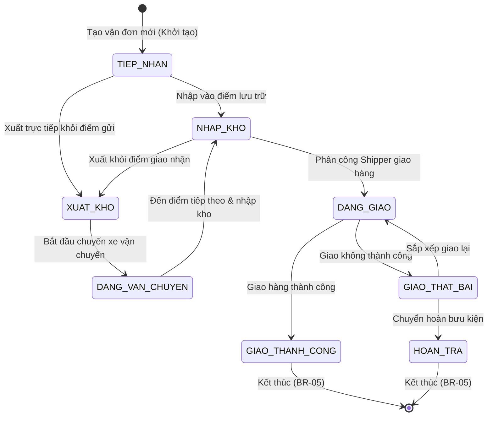

# CHƯƠNG 1 & 2: VÒNG ĐỜI BƯU KIỆN, QUY TẮC NGHIỆP VỤ VÀ MA TRẬN CHUYỂN TRẠNG THÁI

Tài liệu này trình bày bối cảnh bài toán, quy trình nghiệp vụ vận chuyển 5 giai đoạn, hệ thống 7 quy tắc nghiệp vụ cốt lõi (`BR-01` $\rightarrow$ `BR-07`), và mô hình vòng đời trạng thái bưu kiện (State Transition Matrix) của **Đề tài 13: Thiết kế Cơ sở dữ liệu theo dõi vận chuyển và bàn giao bưu kiện**.

---

## 1. Giới thiệu và Mục tiêu Nghiên cứu

### 1.1. Bối cảnh và Tính cấp thiết của Đề tài
Trong hệ sinh thái chuyển phát nhanh hiện đại, một bưu kiện kể từ khi được tiếp nhận tại bưu cục gửi cho đến khi giao tận tay người nhận phải trải qua một hành trình phức tạp, đi qua nhiều trung gian: bưu cục gom hàng, các kho trung chuyển phân loại, các chuyến xe đường dài, bưu cục phát và đội ngũ shipper chặng cuối. Tại mỗi điểm dừng, trách nhiệm pháp lý và bảo quản bưu kiện được chuyển giao thông qua các **"Lần bàn giao"** (`LanBanGiao`). Đồng thời, mỗi thay đổi về vị trí hoặc tình trạng vật lý đều phát sinh các **"Sự kiện trạng thái"** (`SuKienTrangThai`).

Các hệ thống CRUD (Create, Read, Update, Delete) truyền thống bộc lộ hạn chế lớn trước bài toán vận chuyển chuyên sâu do không giải quyết được các thách thức đặc thù:
1. **Tính nhất quán giữa Lịch sử và Trạng thái Hiện tại:** Nếu chỉ lưu lịch sử, mỗi thao tác tra cứu trạng thái đơn hàng bắt buộc phải quét và sắp xếp toàn bộ chuỗi sự kiện trong quá khứ, gây tắc nghẽn nghiêm trọng khi quy mô dữ liệu đạt hàng triệu bản ghi. Ngược lại, nếu chỉ lưu trạng thái hiện tại, hệ thống sẽ mất hoàn toàn khả năng kiểm toán (*audit trail*) và truy xuất nguồn gốc trách nhiệm khi xảy ra sự cố thất lạc hay hư hỏng.
2. **Sự kiện đến muộn (*Out-of-order Events*):** Do nghẽn mạng hoặc thiết bị quét cầm tay (*handheld scanner*) tại kho bãi hoạt động ở chế độ ngoại tuyến (*offline*), một sự kiện nhập kho xảy ra lúc `08:00` có thể bị gửi về máy chủ trung tâm sau sự kiện xuất kho xảy ra lúc `09:00`. Nếu CSDL cập nhật mù quáng (*blind update*), trạng thái bưu kiện sẽ bị đẩy lùi về quá khứ, phá hủy tính đúng đắn của quy trình nghiệp vụ.
3. **Sự kiện gửi trùng (*Duplicate/Retry Events*):** Khi kết nối mạng chập chờn, ứng dụng di động của nhân viên giao hàng có thể tự động gửi lại (*retry*) một sự kiện xác nhận giao hàng nhiều lần. CSDL phải nhận diện và triệt tiêu các sự kiện trùng lặp này dựa trên cơ chế Khóa chống trùng (`idempotency_key`).
4. **Tranh chấp đồng thời (*Concurrency Control*):** Hai tiến trình đồng thời cập nhật trạng thái cho cùng một bưu kiện (ví dụ: Shipper bấm xác nhận giao hàng đồng thời với việc hệ thống tổng đài ghi nhận yêu cầu hoàn trả) có thể dẫn đến hiện tượng ghi đè mất mát dữ liệu (*Lost Update*).

### 1.2. Câu hỏi Nghiên cứu Trọng tâm
- **Câu hỏi Nghiên cứu 1 (Mô hình hóa Kiến trúc & Đánh giá Đổi trừ Hiệu năng):** Nên tính toán trạng thái hiện tại của bưu kiện động từ lịch sử sự kiện (**Phương án A - History-based**) hay lưu trữ trực tiếp trạng thái hiện tại lên thực thể bưu kiện (**Phương án B - Current-state**)? Sự đánh đổi định lượng (*trade-off*) về tốc độ đọc, tốc độ ghi, chi phí bộ đệm và dung lượng lưu trữ giữa hai phương án là gì?
- **Câu hỏi Nghiên cứu 2 (Toàn vẹn Dữ liệu & Kiểm soát Đồng thời):** Làm thế nào để bảo đảm tính nhất quán tuyệt đối của CSDL trước các tình huống sự kiện đến muộn (`BR-06`), sự kiện gửi trùng (`BR-07`) và tranh chấp cập nhật đồng thời thông qua việc kết hợp giữa chỉ mục `UNIQUE (idempotency_key)`, Trigger PL/pgSQL và kỹ thuật khóa bi quan (`SELECT ... FOR UPDATE`)?
- **Câu hỏi Nghiên cứu 3 (Lý thuyết Chuẩn hóa & Phi chuẩn hóa có kiểm soát):** Việc áp dụng lý thuyết phân rã BCNF giúp loại bỏ những dị thường dữ liệu nào? Trong điều kiện tải công việc chiếm >90% thao tác đọc, việc cố ý vi phạm dạng chuẩn 3NF/BCNF ở Phương án B có được biện minh về mặt kỹ thuật hay không và được kiểm soát an toàn bằng cơ chế nào?

---

## 2. Khảo sát Quy trình Nghiệp vụ Vận chuyển (5 Giai đoạn)

Quy trình vận chuyển bưu kiện khép kín trong hệ thống trải qua **5 giai đoạn chính**:

1. **Giai đoạn 1 – Tiếp nhận & Tạo đơn:**
   Khách hàng mang hàng đến Bưu cục gửi (`BuuCuc`). Nhân viên cân đo trọng lượng, kích thước (`dai`, `rong`, `cao`), lập đơn, tính giá khai giá (`gia_khai`), tiền thu hộ (`tien_COD`) và cấp mã định danh duy nhất (`ma_buu_kien` - Tracking ID). Bưu kiện được khởi tạo ở trạng thái `TIEP_NHAN`.
2. **Giai đoạn 2 – Đóng gói & Xuất bưu cục:**
   Bưu kiện được đưa vào lưu trữ tạm tại bưu cục (`NHAP_KHO`) hoặc gom chuyến trực tiếp, lập biên bản bàn giao (`LanBanGiao`) cho nhân sự phụ trách chuyến xe tải để xuất khỏi bưu cục (`XUAT_KHO`), sau đó chuyển sang trạng thái `DANG_VAN_CHUYEN` trên chuyến xe (`ChuyenVanChuyen`).
3. **Giai đoạn 3 – Trung chuyển & Phân loại:**
   Khi xe đến Kho trung chuyển (`KhoTrungChuyen`), nhân viên kho quét nhập kho (`NHAP_KHO`), tiến hành phân loại theo tuyến đường đích (`TuyenVanChuyen`), sau đó xuất kho (`XUAT_KHO`) và xếp lên chuyến xe tiếp theo (`DANG_VAN_CHUYEN`). Quá trình này có thể lặp lại qua nhiều kho trung chuyển.
4. **Giai đoạn 4 – Phân phối về Bưu cục giao:**
   Bưu kiện tới bưu cục đích, được quét nhập kho (`NHAP_KHO`) và phân công cho `Shipper` phụ trách khu vực. Nhân viên lập biên bản bàn giao bưu kiện cho Shipper, trạng thái bưu kiện chuyển thành `DANG_GIAO`.
5. **Giai đoạn 5 – Giao hàng / Hoàn trả:**
   - Nếu Shipper giao thành công cho người nhận $\rightarrow$ chuyển sang trạng thái kết thúc `GIAO_THANH_CONG`.
   - Nếu không giao được (người nhận vắng mặt, không nghe máy...) $\rightarrow$ chuyển sang trạng thái `GIAO_THAT_BAI` (sau đó có thể sắp xếp phát lại $\rightarrow$ `DANG_GIAO`).
   - Nếu giao thất bại nhiều lần hoặc người nhận từ chối nhận hàng $\rightarrow$ chuyển sang trạng thái kết thúc `HOAN_TRA`.

---

## 3. Hệ thống Quy tắc Nghiệp vụ (Business Rules `BR-01` $\rightarrow$ `BR-07`)

Hệ thống thiết lập **7 quy tắc nghiệp vụ cốt lõi (`BR-01` $\rightarrow$ `BR-07`)** ràng buộc trực tiếp đến thiết kế lược đồ và logic xử lý trong CSDL:

| Mã Quy tắc | Tên Quy tắc Nghiệp vụ | Nội dung Chi tiết và Ràng buộc CSDL | Cơ chế Ràng buộc Kernel |
| :---: | :--- | :--- | :--- |
| **BR-01** | **Mã vận đơn duy nhất** | Mỗi bưu kiện được cấp đúng một mã Tracking ID duy nhất (`ma_buu_kien`) ngay khi tiếp nhận. Mã này không thay đổi xuyên suốt vòng đời. | `PRIMARY KEY (ma_buu_kien)` |
| **BR-02** | **Xác định Khách hàng** | Bưu kiện bắt buộc phải gắn với đúng một Người gửi (`ma_khach_hang_gui`) và một Người nhận (`ma_khach_hang_nhan`). | `FOREIGN KEY` + `NOT NULL` |
| **BR-03** | **Chuyển trạng thái hợp lệ** | Trạng thái bưu kiện chỉ được biến đổi theo đồ thị chuyển đổi trạng thái hợp lệ; không được tự ý bỏ qua các bước nghiệp vụ bắt buộc. | Hàm kiểm tra `fn_kiem_tra_chuyen_trang_thai` / Trigger Validation |
| **BR-04** | **Ghi nhận Bàn giao** | Mỗi lần bàn giao trách nhiệm bắt buộc phải ghi nhận bưu kiện, nhân viên thực hiện, địa điểm, thời gian, chuyến xe liên quan (nếu có) và tình trạng vật lý. | `LanBanGiao` Schema Integrity (`FK`, `NOT NULL`) |
| **BR-05** | **Trạng thái Kết thúc** | `GIAO_THANH_CONG` và `HOAN_TRA` là các trạng thái kết thúc (*Terminal States*). Khi đạt tới các trạng thái này, không phát sinh thêm trạng thái mới. | Constraint Check trong Function / Trigger |
| **BR-06** | **Sự kiện đến muộn** | Sự kiện đến muộn vẫn được lưu đầy đủ vào lịch sử sự kiện nhưng tuyệt đối không được làm trạng thái hiện tại bị quay lùi về quá khứ. | Trigger Logic (`NEW.thoi_gian_xay_ra >= thoi_gian_cap_nhat_cuoi`) |
| **BR-07** | **Khóa chống gửi trùng** | Các sự kiện được gửi lại do cơ chế retry mạng không được tạo thêm sự kiện nghiệp vụ trùng trong CSDL. | `UNIQUE (idempotency_key)` + `ON CONFLICT DO NOTHING` |

*Bảng 2.1: Bảng Ma trận Quy tắc Nghiệp vụ (`BR-01` $\rightarrow$ `BR-07`).*

---

## 4. Mô hình Trạng thái Vòng đời Bưu kiện (State Transition Matrix)

### 4.1. Danh mục 8 Trạng thái Nghiệp vụ
Trong toàn bộ vòng đời, bưu kiện đi qua tập **8 trạng thái chuẩn hóa**:
1. `TIEP_NHAN` *(Khởi đầu)*: Bưu kiện vừa được tiếp nhận và tạo mã vận đơn tại bưu cục gửi.
2. `NHAP_KHO` *(Trung gian)*: Bưu kiện được đưa vào lưu trữ tại bưu cục hoặc kho trung chuyển.
3. `XUAT_KHO` *(Trung gian)*: Bưu kiện được xuất khỏi bưu cục hoặc kho trung chuyển để chuẩn bị lên xe.
4. `DANG_VAN_CHUYEN` *(Trung gian)*: Bưu kiện đang di chuyển trên chuyến xe vận chuyển giữa các điểm.
5. `DANG_GIAO` *(Trung gian)*: Shipper đang mang bưu kiện đi phát cho người nhận ở chặng cuối.
6. `GIAO_THAT_BAI` *(Trung gian)*: Lượt phát hàng không thành công, chờ phát lại hoặc xử lý hoàn trả.
7. `GIAO_THANH_CONG` *(Kết thúc - Terminal State)*: Người nhận đã nhận hàng thành công.
8. `HOAN_TRA` *(Kết thúc - Terminal State)*: Bưu kiện được quyết định chuyển hoàn về người gửi.

### 4.2. Sơ đồ Máy trạng thái (State Diagram)



### 4.3. Bảng Ma trận Chuyển đổi Trạng thái Hợp lệ
Chuỗi chuyển đổi trạng thái của bưu kiện tuân thủ chặt chẽ **10 bước chuyển đổi hợp lệ** (cùng bước khởi tạo ban đầu) theo quy tắc `BR-03` và `BR-05`:

| STT | Trạng thái Hiện tại | Sự kiện / Điều kiện Kích hoạt | Trạng thái Mới | Tính chất Trạng thái |
| :---: | :--- | :--- | :--- | :--- |
| **0** | `NULL` *(Chưa có)* | Tiếp nhận bưu kiện tại bưu cục gửi | `TIEP_NHAN` | Khởi tạo (*Initial State*) |
| **1** | `TIEP_NHAN` | Nhập vào điểm lưu trữ | `NHAP_KHO` | Khởi đầu |
| **2** | `TIEP_NHAN` | Xuất trực tiếp khỏi điểm gửi | `XUAT_KHO` | Khởi đầu |
| **3** | `NHAP_KHO` | Xuất khỏi điểm giao nhận | `XUAT_KHO` | Trung gian (*Intermediate*) |
| **4** | `NHAP_KHO` | Phân công Shipper giao hàng | `DANG_GIAO` | Trung gian (*Intermediate*) |
| **5** | `XUAT_KHO` | Bắt đầu chuyến vận chuyển | `DANG_VAN_CHUYEN` | Trung gian (*Intermediate*) |
| **6** | `DANG_VAN_CHUYEN` | Đến điểm tiếp theo và nhập kho | `NHAP_KHO` | Trung gian (*Intermediate*) |
| **7** | `DANG_GIAO` | Giao hàng thành công cho người nhận | `GIAO_THANH_CONG` | **Kết thúc (*Terminal State* - `BR-05`)** |
| **8** | `DANG_GIAO` | Giao không thành công | `GIAO_THAT_BAI` | Trung gian (*Intermediate*) |
| **9** | `GIAO_THAT_BAI` | Sắp xếp giao lại | `DANG_GIAO` | Trung gian (*Intermediate*) |
| **10** | `GIAO_THAT_BAI` | Xác nhận chuyển hoàn | `HOAN_TRA` | **Kết thúc (*Terminal State* - `BR-05`)** |

*Bảng 3.2: Bảng Ma trận chuyển đổi trạng thái nghiệp vụ (State Transition Matrix).*

---

## 5. Hiện thực Kiểm tra và Kiểm toán Chuyển trạng thái trong PostgreSQL

### 5.1. Hàm kiểm tra bước chuyển trạng thái hợp lệ (`pa_b.fn_kiem_tra_chuyen_trang_thai`)
Trong file [sql/05_sql_advanced.sql](file:///c:/CSDLnangcao/CSDLNC-Nhom13-van-chuyen-buu-kien/sql/05_sql_advanced.sql#L377-L405), quy tắc `BR-03` và `BR-05` được đóng gói thành hàm PL/pgSQL phục vụ kiểm tra tức thì trước khi cập nhật trạng thái:

```sql
CREATE OR REPLACE FUNCTION pa_b.fn_kiem_tra_chuyen_trang_thai(
    p_trang_thai_cu  VARCHAR,
    p_trang_thai_moi VARCHAR
) RETURNS BOOLEAN AS $$
BEGIN
    -- Bước khởi tạo ban đầu
    IF p_trang_thai_cu IS NULL AND p_trang_thai_moi = 'TIEP_NHAN' THEN
        RETURN TRUE;
    END IF;

    -- Không cho phép chuyển tiếp từ trạng thái kết thúc (BR-05)
    IF p_trang_thai_cu IN ('GIAO_THANH_CONG', 'HOAN_TRA') THEN
        RETURN FALSE;
    END IF;

    -- Kiểm tra 10 bước chuyển trạng thái hợp lệ (BR-03)
    RETURN (p_trang_thai_cu, p_trang_thai_moi) IN (
        ('TIEP_NHAN',       'NHAP_KHO'),
        ('TIEP_NHAN',       'XUAT_KHO'),
        ('NHAP_KHO',        'XUAT_KHO'),
        ('NHAP_KHO',        'DANG_GIAO'),
        ('XUAT_KHO',        'DANG_VAN_CHUYEN'),
        ('DANG_VAN_CHUYEN', 'NHAP_KHO'),
        ('DANG_GIAO',       'GIAO_THANH_CONG'),
        ('DANG_GIAO',       'GIAO_THAT_BAI'),
        ('GIAO_THAT_BAI',   'DANG_GIAO'),
        ('GIAO_THAT_BAI',   'HOAN_TRA')
    );
END;
$$ LANGUAGE plpgsql IMMUTABLE;
```

### 5.2. Truy vấn Kiểm toán (Audit) Lịch sử Chuyển trạng thái bằng Hàm cửa sổ `LAG()`
Để đối soát toàn bộ dữ liệu lịch sử trong `SuKienTrangThai` xem có cặp sự kiện liên tiếp nào vi phạm `BR-03` (chuyển nhảy cóc) hoặc `BR-05` (phát sinh sự kiện sau khi đã kết thúc) hay không, hệ thống sử dụng câu truy vấn **Q9** ([sql/05_sql_advanced.sql](file:///c:/CSDLnangcao/CSDLNC-Nhom13-van-chuyen-buu-kien/sql/05_sql_advanced.sql#L328-L363)):

```sql
WITH cap_chuyen_trang_thai AS (
    SELECT
        sk.ma_buu_kien,
        sk.ma_su_kien,
        LAG(sk.ma_trang_thai) OVER (
            PARTITION BY sk.ma_buu_kien
            ORDER BY sk.thoi_gian_xay_ra, sk.ma_su_kien
        ) AS trang_thai_truoc,
        sk.ma_trang_thai AS trang_thai_moi,
        sk.thoi_gian_xay_ra
    FROM pa_a.SuKienTrangThai sk
)
SELECT
    trang_thai_truoc,
    trang_thai_moi,
    COUNT(*) AS so_luot_chuyen,
    CASE
        WHEN trang_thai_truoc IS NULL AND trang_thai_moi = 'TIEP_NHAN' THEN 'HOP_LE (Khoi tao)'
        WHEN (trang_thai_truoc, trang_thai_moi) IN (
            ('TIEP_NHAN',       'NHAP_KHO'),
            ('TIEP_NHAN',       'XUAT_KHO'),
            ('NHAP_KHO',        'XUAT_KHO'),
            ('NHAP_KHO',        'DANG_GIAO'),
            ('XUAT_KHO',        'DANG_VAN_CHUYEN'),
            ('DANG_VAN_CHUYEN', 'NHAP_KHO'),
            ('DANG_GIAO',       'GIAO_THANH_CONG'),
            ('DANG_GIAO',       'GIAO_THAT_BAI'),
            ('GIAO_THAT_BAI',   'DANG_GIAO'),
            ('GIAO_THAT_BAI',   'HOAN_TRA')
        ) THEN 'HOP_LE (Theo State Transition)'
        WHEN trang_thai_truoc IN ('GIAO_THANH_CONG', 'HOAN_TRA') THEN 'VI_PHAM BR-05 (Sau trang thai ket thuc)'
        ELSE 'VI_PHAM BR-03 (Chuyen nhay coc / Sai luong)'
    END AS ket_luan_kiem_toan
FROM cap_chuyen_trang_thai
GROUP BY trang_thai_truoc, trang_thai_moi
ORDER BY ket_luan_kiem_toan, so_luot_chuyen DESC;
```
