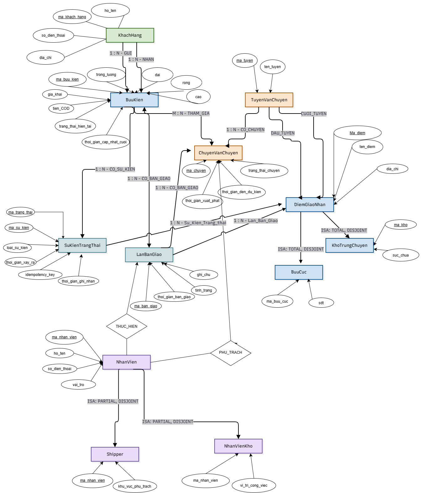

# CHƯƠNG 3 & 4: MÔ HÌNH QUAN NIỆM EER, TỪ ĐIỂN DỮ LIỆU VÀ THIẾT KẾ LOGIC – CHUẨN HÓA BCNF

Tài liệu này đặc tả toàn diện Mô hình Thực thể - Kết hợp Mở rộng (EER), Từ điển dữ liệu, chiến lược ánh xạ kế thừa, và quy trình chuẩn hóa toán học (Phụ thuộc hàm, Bao đóng $X^+$, Khóa ứng viên, Phủ tối tiểu $F_c$, kiểm chứng BCNF, Lossless Join, Dependency Preservation và phân tích 4NF) của **Đề tài 13**.

---

## 1. Mô hình Quan niệm EER (Enhanced Entity-Relationship)

### 1.1. Nguyên lý Thiết kế và Sơ đồ Tổng thể
Mô hình Thực thể - Kết hợp Mở rộng (EER) được thiết kế tuân thủ nghiêm ngặt chuẩn ký hiệu Elmasri & Navathe. Mô hình biểu diễn chính xác cấu trúc phân cấp kế thừa chuyên biệt hóa, các mối quan hệ kết hợp nhiều-nhiều, và quan hệ bàn giao trách nhiệm giữa các đối tượng.


*Sơ đồ 3.1: Mô tả cấu trúc Sơ đồ EER Hệ thống Vận chuyển và Bàn giao Bưu kiện.*

---

### 1.2. Bảng Phân loại 14 Thực thể và Thuộc tính Đặc thù
Hệ thống gồm **14 thực thể/quan hệ** được phân loại chi tiết trong Bảng 3.1:

| STT | Thực thể | Vai trò EER | Khóa chính (PK) | Thuộc tính Đặc thù / Mô tả |
| :---: | :--- | :--- | :--- | :--- |
| **1** | `BuuKien` | Thực thể trung tâm | `ma_buu_kien` | `trong_luong`, `dai`, `rong`, `cao`, `gia_khai`, `tien_COD` *(PA_B có thêm `trang_thai_hien_tai`, `thoi_gian_cap_nhat_cuoi`)* |
| **2** | `KhachHang` | Thực thể mạnh | `ma_khach_hang` | `ho_ten`, `sdt`, `dia_chi` |
| **3** | `DiemGiaoNhan` | Superclass (Lớp cha) | `ma_diem_giao_nhan` | `ten_diem`, `dia_chi` |
| **4** | `BuuCuc` | Subclass (Lớp con) | `ma_diem_giao_nhan` | `ma_buu_cuc` (`UNIQUE`), `sdt` |
| **5** | `KhoTrungChuyen` | Subclass (Lớp con) | `ma_diem_giao_nhan` | `ma_kho` (`UNIQUE`), `suc_chua` |
| **6** | `TuyenVanChuyen` | Thực thể mạnh | `ma_tuyen` | `ten_tuyen`, `dau_tuyen`, `cuoi_tuyen` |
| **7** | `ChuyenVanChuyen` | Thực thể mạnh | `ma_chuyen` | `ma_tuyen`, `thoi_gian_xuat_phat`, `thoi_gian_den_du_kien`, `trang_thai_chuyen` |
| **8** | `ChiTietChuyenVanChuyen` | Relation Entity ($N:M$) | `{ma_chuyen, ma_buu_kien}` | `thoi_gian_xep_xe` |
| **9** | `NhanVien` | Superclass (Lớp cha) | `ma_nhan_vien` | `ho_ten`, `so_dien_thoai`, `vai_tro` |
| **10** | `Shipper` | Subclass (Lớp con) | `ma_nhan_vien` | `khu_vuc_phu_trach` |
| **11** | `NhanVienKho` | Subclass (Lớp con) | `ma_nhan_vien` | `vi_tri_cong_viec` |
| **12** | `PhuTrach` | Relation Entity ($N:M$) | `{ma_nhan_vien, ma_chuyen}` | Phân công nhân sự đi theo chuyến xe vận chuyển |
| **13** | `LanBanGiao` | Thực thể giao dịch | `ma_ban_giao` | `ma_buu_kien`, `ma_nhan_vien`, `ma_diem_giao_nhan`, `ma_chuyen`, `thoi_gian_ban_giao`, `tinh_trang`, `ghi_chu` |
| **14** | `SuKienTrangThai` | Lịch sử sự kiện | `ma_su_kien` | `ma_buu_kien`, `ma_trang_thai`, `ma_diem`, `loai_su_kien`, `thoi_gian_xay_ra`, `thoi_gian_ghi_nhan`, `idempotency_key` (`UNIQUE`) |

*Bảng 3.1: Bảng phân loại 14 thực thể và thuộc tính đặc thù trong EER.*

---

### 1.3. Phân biệt Bưu kiện, Chuyến vận chuyển, Lần bàn giao và Sự kiện trạng thái
Một yêu cầu thiết kế cốt lõi của Đề tài 13 là tách biệt rõ ngữ nghĩa giữa 4 khái niệm thường bị nhầm lẫn trong giao vận:

1. **Bưu kiện (`BuuKien`):** Là đối tượng vật lý cần vận chuyển từ người gửi đến người nhận, mang định danh duy nhất `ma_buu_kien` (`BR-01`) không đổi trong suốt vòng đời cùng các thông số vật lý/tài chính (`trong_luong`, `dai`, `rong`, `cao`, `gia_khai`, `tien_COD`).
2. **Chuyến vận chuyển (`ChuyenVanChuyen`) & Chi tiết chuyến (`ChiTietChuyenVanChuyen`):** `ChuyenVanChuyen` là một lượt xe chạy thực tế trên một `TuyenVanChuyen` theo lịch trình (`thoi_gian_xuat_phat`, `thoi_gian_den_du_kien`). Một chuyến xe chở nhiều bưu kiện và một bưu kiện có thể đi qua nhiều chuyến xe trung chuyển khác nhau (quan hệ $N:M$ thông qua `ChiTietChuyenVanChuyen`).
3. **Lần bàn giao (`LanBanGiao`):** Là **biên bản chuyển giao trách nhiệm pháp lý và bảo quản vật lý** (`BR-04`) của một bưu kiện tại một điểm giao nhận (`ma_diem_giao_nhan`), do một nhân sự cụ thể (`ma_nhan_vien`) thực hiện, gắn với chuyến xe (`ma_chuyen` - nếu bàn giao lên/xuống xe) và ghi nhận rõ tình trạng vật lý (`tinh_trang`: `'NGUYEN_VEN'`, móp méo, rách vỡ...) cùng `ghi_chu`.
4. **Sự kiện trạng thái (`SuKienTrangThai`) và Quy định Định danh Duy nhất:**
   - Là **bản ghi dấu vết thời gian (event log)** phản ánh việc bưu kiện đạt tới một mốc trạng thái nghiệp vụ (`ma_trang_thai`) tại một điểm (`ma_diem`).
   - Mỗi sự kiện có **2 mức định danh duy nhất** tương đương:
     - **Khóa chính nội bộ (`ma_su_kien` - `PRIMARY KEY`):** Định danh bản ghi sự kiện trong CSDL.
     - **Khóa chống gửi trùng (`idempotency_key` - `UNIQUE NOT NULL` theo `BR-07`):** Định danh duy nhất do thiết bị đầu cuối/client sinh ra cho mỗi thao tác nghiệp vụ, đảm bảo nếu client gửi lặp (retry do rớt mạng) thì hệ thống nhận diện được ngay và không sinh bản ghi sự kiện trùng lặp.

---

### 1.4. Phân tích Ràng buộc Chuyên biệt hóa (Specialization / Generalization)
Trong mô hình EER, có 2 cấu trúc phân cấp chuyên biệt hóa được thiết lập:

1. **Phân cấp `DiemGiaoNhan` $\rightarrow$ `{BuuCuc, KhoTrungChuyen}` (`ISA: TOTAL, DISJOINT`):**
   - **Ràng buộc Rời rạc (*Disjointness* - `d`):** Một điểm giao nhận cụ thể chỉ được là Bưu cục hoặc Kho trung chuyển, không thể đồng thời là cả hai:
     $$E_{\text{BuuCuc}} \cap E_{\text{KhoTrungChuyen}} = \emptyset$$
   - **Ràng buộc Toàn phần (*Total Completeness* - `t`):** Mọi điểm giao nhận tồn tại trong mạng lưới bắt buộc phải thuộc về một trong hai lớp con:
     $$E_{\text{BuuCuc}} \cup E_{\text{KhoTrungChuyen}} = E_{\text{DiemGiaoNhan}}$$

2. **Phân cấp `NhanVien` $\rightarrow$ `{Shipper, NhanVienKho}` (`ISA: PARTIAL, DISJOINT`):**
   - **Ràng buộc Rời rạc (*Disjointness* - `d`):** Nhân viên giao hàng chặng cuối (`Shipper`) và nhân viên vận hành kho (`NhanVienKho`) là hai vai trò tách biệt:
     $$E_{\text{Shipper}} \cap E_{\text{NhanVienKho}} = \emptyset$$
   - **Ràng buộc Bộ phận (*Partial Completeness* - `p`):** Trên tập nhân sự toàn công ty còn có các nhân viên thuộc bộ phận quản lý, điều phối hoặc hành chính (không nằm trong 2 bảng con `Shipper` hay `NhanVienKho`).

### 1.5. So sánh 3 Chiến lược Ánh xạ Kế thừa xuống Lược đồ Quan hệ
Khi ánh xạ 2 cây kế thừa `DiemGiaoNhan` và `NhanVien` sang các bảng vật lý trên PostgreSQL ([sql/01_init_schemas.sql](file:///c:/CSDLnangcao/CSDLNC-Nhom13-van-chuyen-buu-kien/sql/01_init_schemas.sql)), nhóm đối sánh 3 chiến lược kinh điển:

| Tiêu chí Đánh giá | 1. Single Table (Một Bảng duy nhất) | 2. Joined Table (**Áp dụng trong Đồ án**) | 3. Table Per Class (Bảng riêng từng Lớp con) |
| :--- | :--- | :--- | :--- |
| **Cấu trúc Bảng Vật lý** | Gom tất cả lớp cha và con vào đúng 1 bảng duy nhất | 1 Bảng thực thể Cha + các Bảng thực thể Con nối qua PK/FK | Tạo các bảng độc lập cho từng lớp con (chứa cả cột cha) |
| **Tỷ lệ Giá trị `NULL`** | Rất cao (60% – 80% do cột riêng của lớp khác bị bỏ trống) | **0%** (Triệt tiêu hoàn toàn giá trị `NULL` dư thừa) | 0% |
| **Ràng buộc `NOT NULL` / `UNIQUE`** | Không thể áp dụng chặt chẽ cho các thuộc tính riêng | **Áp dụng triệt để và an toàn tuyệt đối** (ví dụ `ma_buu_cuc UNIQUE NOT NULL`) | Áp dụng được cho từng bảng nhưng khó kiểm soát trùng khóa toàn cục |
| **Truy vấn Đa hình** | Rất nhanh (chỉ cần quét trên 1 bảng) | Cần phép nối `JOIN` giữa Bảng cha và Bảng con qua PK | Phức tạp, phải dùng `UNION ALL` trên nhiều bảng |
| **Đánh giá Lựa chọn** | Lãng phí bộ nhớ lưu trữ và lỏng lẻo về ràng buộc | **Tối ưu chuẩn hóa BCNF, bảo toàn toàn vẹn tham chiếu chung** | Phức tạp khi các bảng khác (`SuKienTrangThai`, `LanBanGiao`) cần tham chiếu FK tới lớp cha |

*Bảng 6.1: So sánh định lượng 3 chiến lược ánh xạ kế thừa (Single Table, Joined Table, Table Per Class).*

---

## 2. Từ điển Dữ liệu (Data Dictionary)

Dưới đây là đặc tả chi tiết từ điển dữ liệu của các thực thể trung tâm trong hệ thống:

### Bảng 2.2: Từ điển dữ liệu thực thể `BuuKien`
| Tên Thuộc tính | Kiểu Dữ liệu | Ràng buộc | Diễn giải Nghiệp vụ |
| :--- | :--- | :--- | :--- |
| `ma_buu_kien` | `VARCHAR(20)` | `PRIMARY KEY` | Mã định danh vận đơn duy nhất (`BR-01`) |
| `ma_khach_hang_gui` | `VARCHAR(20)` | `FK -> KhachHang`, `NOT NULL` | Mã người gửi hàng (`BR-02`) |
| `ma_khach_hang_nhan` | `VARCHAR(20)` | `FK -> KhachHang`, `NOT NULL` | Mã người nhận hàng (`BR-02`) |
| `trong_luong` | `NUMERIC(8,2)` | `NOT NULL`, `CHECK (> 0)` | Trọng lượng tính cước (kg) |
| `dai`, `rong`, `cao` | `NUMERIC(6,1)` | `CHECK (> 0)` | Kích thước ba chiều của bưu kiện (cm) |
| `gia_khai` | `NUMERIC(12,2)` | `DEFAULT 0`, `CHECK (>= 0)` | Giá trị hàng hóa khai báo (VNĐ) |
| `tien_COD` | `NUMERIC(12,2)` | `DEFAULT 0`, `CHECK (>= 0)` | Tiền thu hộ khi giao hàng (VNĐ) |
| `trang_thai_hien_tai` | `VARCHAR(30)` | *Chỉ có ở `pa_b` (Derived)* | Trạng thái hiện tại của bưu kiện (Phi chuẩn hóa có kiểm soát) |
| `thoi_gian_cap_nhat_cuoi` | `TIMESTAMP` | *Chỉ có ở `pa_b` (Derived)* | Thời điểm xảy ra sự kiện cập nhật trạng thái mới nhất |

### Bảng 2.3: Từ điển dữ liệu thực thể `DiemGiaoNhan` (và lớp con `BuuCuc`, `KhoTrungChuyen`)
| Tên Thuộc tính | Bảng | Kiểu Dữ liệu | Ràng buộc | Diễn giải Nghiệp vụ |
| :--- | :--- | :--- | :--- | :--- |
| `ma_diem_giao_nhan` | `DiemGiaoNhan` | `VARCHAR(20)` | `PRIMARY KEY` | Mã định danh nút giao vận trong mạng lưới |
| `ten_diem` | `DiemGiaoNhan` | `VARCHAR(100)` | `NOT NULL` | Tên bưu cục hoặc kho trung chuyển |
| `dia_chi` | `DiemGiaoNhan` | `TEXT` | `NOT NULL` | Địa chỉ vật lý của điểm giao nhận |
| `ma_buu_cuc` | `BuuCuc` | `VARCHAR(20)` | `UNIQUE NOT NULL` | Mã nghiệp vụ riêng của Bưu cục |
| `sdt` | `BuuCuc` | `VARCHAR(15)` | `NULL` | Số điện thoại liên hệ của Bưu cục |
| `ma_kho` | `KhoTrungChuyen` | `VARCHAR(20)` | `UNIQUE NOT NULL` | Mã nghiệp vụ riêng của Kho trung chuyển |
| `suc_chua` | `KhoTrungChuyen` | `NUMERIC(10,2)` | `CHECK (> 0)` | Sức chứa lưu trữ tối đa của kho |

### Bảng 2.4: Từ điển dữ liệu thực thể `LanBanGiao`
| Tên Thuộc tính | Kiểu Dữ liệu | Ràng buộc | Diễn giải Nghiệp vụ |
| :--- | :--- | :--- | :--- |
| `ma_ban_giao` | `VARCHAR(20)` | `PRIMARY KEY` | Mã biên bản bàn giao duy nhất (`BR-04`) |
| `ma_buu_kien` | `VARCHAR(20)` | `FK -> BuuKien`, `NOT NULL` | Bưu kiện được bàn giao |
| `ma_nhan_vien` | `VARCHAR(20)` | `FK -> NhanVien`, `NOT NULL` | Nhân sự chịu trách nhiệm thực hiện bàn giao |
| `ma_diem_giao_nhan` | `VARCHAR(20)` | `FK -> DiemGiaoNhan`, `NOT NULL` | Địa điểm thực hiện bàn giao |
| `ma_chuyen` | `VARCHAR(20)` | `FK -> ChuyenVanChuyen`, `NULL` | Chuyến xe vận chuyển liên quan (nếu có) |
| `thoi_gian_ban_giao` | `TIMESTAMP` | `DEFAULT CURRENT_TIMESTAMP` | Thời điểm lập biên bản bàn giao |
| `tinh_trang` | `VARCHAR(50)` | `DEFAULT 'NGUYEN_VEN'` | Tình trạng vật lý bưu kiện khi bàn giao |
| `ghi_chu` | `TEXT` | `NULL` | Ghi chú bất thường (nếu có) |

### Bảng 2.5: Từ điển dữ liệu thực thể `SuKienTrangThai`
| Tên Thuộc tính | Kiểu Dữ liệu | Ràng buộc | Diễn giải Nghiệp vụ |
| :--- | :--- | :--- | :--- |
| `ma_su_kien` | `VARCHAR(20)` | `PRIMARY KEY` | Mã sự kiện trạng thái duy nhất |
| `ma_buu_kien` | `VARCHAR(20)` | `FK -> BuuKien`, `NOT NULL` | Bưu kiện phát sinh sự kiện |
| `ma_trang_thai` | `VARCHAR(30)` | `NOT NULL` | Mã trạng thái nghiệp vụ phát sinh |
| `ma_diem` | `VARCHAR(20)` | `FK -> DiemGiaoNhan`, `NOT NULL` | Địa điểm phát sinh sự kiện |
| `loai_su_kien` | `VARCHAR(50)` | `NOT NULL` | Phân loại hành vi nghiệp vụ |
| `thoi_gian_xay_ra` | `TIMESTAMP` | `NOT NULL` | Thời điểm sự kiện thực sự diễn ra (`BR-06` - Event Time) |
| `thoi_gian_ghi_nhan` | `TIMESTAMP` | `DEFAULT CURRENT_TIMESTAMP` | Thời điểm CSDL ghi nhận dòng dữ liệu (Ingest Time) |
| `idempotency_key` | `VARCHAR(100)` | `UNIQUE NOT NULL` | Khóa chống trùng lặp dữ liệu retry (`BR-07`) |

---

## 3. Thiết kế Mức Logic và Chuẩn hóa Dữ liệu

### 3.1. Tập Thuộc tính Tổng thể ($U$) và Tập Phụ thuộc hàm ($F$)

#### 3.1.1. Tập thuộc tính tổng thể ($U$)
Tập thuộc tính tổng thể $U$ bao gồm **42 thuộc tính** (tương ứng 36 thuộc tính gốc khi hợp nhất các khóa ngoại đồng danh) thuộc 14 quan hệ:

```text
U = {
    ma_khach_hang, ho_ten, sdt, dia_chi,
    ma_buu_kien, ma_khach_hang_gui, ma_khach_hang_nhan, trong_luong, dai, rong, cao, gia_khai, tien_COD,
    ma_diem_giao_nhan, ten_diem, ma_buu_cuc, ma_kho, suc_chua,
    ma_tuyen, ten_tuyen, dau_tuyen, cuoi_tuyen,
    ma_chuyen, thoi_gian_xuat_phat, thoi_gian_den_du_kien, trang_thai_chuyen,
    thoi_gian_xep_xe,
    ma_nhan_vien, so_dien_thoai, vai_tro, khu_vuc_phu_trach, vi_tri_cong_viec,
    ma_ban_giao, thoi_gian_ban_giao, tinh_trang, ghi_chu,
    ma_su_kien, ma_trang_thai, ma_diem, loai_su_kien, thoi_gian_xay_ra, thoi_gian_ghi_nhan, idempotency_key
}
```
*Bảng 4.1: Danh mục Thuộc tính Tổng thể ($U$) của Hệ thống Vận chuyển.*

#### 3.1.2. Danh mục 17 Phụ thuộc hàm ($FD_1 \rightarrow FD_{17}$)
Từ các quy tắc nghiệp vụ `BR-01` $\rightarrow$ `BR-07` và mô hình EER, nhóm trích xuất tập **17 Phụ thuộc hàm** $F = \{FD_1, FD_2, \dots, FD_{17}\}$:

| Ký hiệu | Vế trái ($X$) | Vế phải ($Y$) | Nguồn gốc BR / EER | Diễn giải Ngữ nghĩa Nghiệp vụ |
| :---: | :--- | :--- | :---: | :--- |
| **FD1** | `ma_buu_kien` | `ma_khach_hang_gui, ma_khach_hang_nhan, trong_luong, dai, rong, cao, gia_khai, tien_COD` | `BR-01`, `BR-02` | Mã bưu kiện xác định thông tin người gửi, người nhận, kích thước và tiền cước. |
| **FD2** | `ma_khach_hang` | `ho_ten, sdt, dia_chi` | `BR-02` | Mã khách hàng xác định hồ sơ cá nhân và địa chỉ liên lạc. |
| **FD3** | `ma_su_kien` | `ma_buu_kien, ma_trang_thai, ma_diem, loai_su_kien, thoi_gian_xay_ra, thoi_gian_ghi_nhan, idempotency_key` | `BR-03`, `BR-06` | Mã sự kiện xác định trọn vẹn chi tiết sự kiện lịch sử hành trình. |
| **FD4** | `idempotency_key` | `ma_su_kien, ma_buu_kien, ma_trang_thai, ma_diem, loai_su_kien, thoi_gian_xay_ra, thoi_gian_ghi_nhan` | `BR-07` | Khóa chống trùng xác định duy nhất sự kiện trạng thái tương ứng. |
| **FD5** | `ma_ban_giao` | `ma_buu_kien, ma_nhan_vien, ma_diem_giao_nhan, ma_chuyen, thoi_gian_ban_giao, tinh_trang, ghi_chu` | `BR-04` | Mã bàn giao xác định nhân sự, địa điểm, thời gian và tình trạng bưu kiện. |
| **FD6** | `ma_diem_giao_nhan` | `ten_diem, dia_chi` | EER: `DGN` | Mã điểm giao nhận xác định tên điểm và địa chỉ vật lý. |
| **FD7** | `ma_diem_giao_nhan` | `ma_buu_cuc, sdt` | EER: `BC` (1:1) | Điểm giao nhận bưu cục xác định mã bưu cục và số điện thoại. |
| **FD8** | `ma_buu_cuc` | `ma_diem_giao_nhan, sdt` | EER: `BC` | Mã bưu cục là khóa ứng viên thay thế tương đương. |
| **FD9** | `ma_diem_giao_nhan` | `ma_kho, suc_chua` | EER: `KTC` (1:1) | Điểm giao nhận kho xác định mã kho và sức chứa lưu trữ. |
| **FD10** | `ma_kho` | `ma_diem_giao_nhan, suc_chua` | EER: `KTC` | Mã kho là khóa ứng viên thay thế tương đương. |
| **FD11** | `ma_tuyen` | `ten_tuyen, dau_tuyen, cuoi_tuyen` | EER: `TVC` | Mã tuyến vận chuyển xác định tên tuyến, điểm đầu và điểm cuối. |
| **FD12** | `ma_chuyen` | `ma_tuyen, thoi_gian_xuat_phat, thoi_gian_den_du_kien, trang_thai_chuyen` | EER: `CVC` | Mã chuyến xe xác định tuyến đường, lịch trình và trạng thái vận hành. |
| **FD13** | `{ma_chuyen, ma_buu_kien}` | `thoi_gian_xep_xe` | EER: `CTC` | Cặp `{chuyến, bưu kiện}` xác định thời điểm bốc xếp hàng lên xe. |
| **FD14** | `ma_nhan_vien` | `ho_ten, so_dien_thoai, vai_tro` | EER: `NV` | Mã nhân viên xác định hồ sơ lý lịch và chức danh công tác. |
| **FD15** | `ma_nhan_vien` | `khu_vuc_phu_trach` | EER: `SP` | Chuyên biệt hóa Shipper xác định địa bàn phụ trách giao hàng. |
| **FD16** | `ma_nhan_vien` | `vi_tri_cong_viec` | EER: `NVK` | Chuyên biệt hóa Nhân viên kho xác định vị trí công tác tại kho. |
| **FD17** | `{ma_nhan_vien, ma_chuyen}` | `{ma_nhan_vien, ma_chuyen}` | EER: `PT` | Phụ thuộc tầm thường xác định phân công nhân sự đi theo chuyến xe. |

*Bảng 4.2: Danh mục 17 Phụ thuộc hàm ($FD_1 \rightarrow FD_{17}$) trích xuất từ Nghiệp vụ.*

---

### 3.2. Thuật toán Tìm Bao đóng ($X^+$) và Xác định Khóa ứng viên

Thuật toán tính bao đóng $X^+$ dựa trên Hệ tiên đề Armstrong:
1. Khởi tạo $X^{(0)} = X$.
2. Lặp: $X^{(i+1)} = X^{(i)} \cup \{ Z \mid \exists (Y \rightarrow Z) \in F \text{ sao cho } Y \subseteq X^{(i)} \}$.
3. Dừng khi $X^{(i+1)} = X^{(i)}$. Trả về $X^+ = X^{(i)}$.

#### Chứng minh từng bước 4 ví dụ điển hình:
- **Ví dụ 1: Tính bao đóng $\{\text{ma\_buu\_kien}\}^+$ trên quan hệ `BuuKien`**
  - $X^{(0)} = \{\text{ma\_buu\_kien}\}$.
  - Áp dụng `FD1`: $\text{ma\_buu\_kien} \rightarrow \{\text{ma\_khach\_hang\_gui, ma\_khach\_hang\_nhan, trong\_luong, dai, rong, cao, gia\_khai, tien\_COD}\}$.
  - $X^{(1)} = \{\text{ma\_buu\_kien, ma\_khach\_hang\_gui, ma\_khach\_hang\_nhan, trong\_luong, dai, rong, cao, gia\_khai, tien\_COD}\}$.
  - Áp dụng `FD2` qua các tham chiếu đến `ma_khach_hang_gui` và `ma_khach_hang_nhan`, suy ra các thuộc tính cá nhân từ tập $U$: người gửi xác định `{ho_ten, sdt, dia_chi}`, người nhận xác định `{ho_ten, sdt, dia_chi}`.
  - $X^{(2)} = X^{(1)} \cup \{\text{ho\_ten, sdt, dia\_chi}\} = U_{\text{BuuKien\_Extended}}$.
  - Thuật toán dừng do không thêm thuộc tính mới. Do $\{\text{ma\_buu\_kien}\}^+$ bao phủ toàn bộ thuộc tính thuộc quan hệ `BuuKien`, nên `ma_buu_kien` là Khóa ứng viên duy nhất.

- **Ví dụ 2: Tính bao đóng $\{\text{ma\_su\_kien}\}^+$ và $\{\text{idempotency\_key}\}^+$ trên `SuKienTrangThai`**
  - Với $X = \{\text{ma\_su\_kien}\}$: Áp dụng `FD3` $\Rightarrow X^+ = U_{\text{SuKienTrangThai}}$.
  - Với $X = \{\text{idempotency\_key}\}$: Áp dụng `FD4` $\Rightarrow X^+ = U_{\text{SuKienTrangThai}}$.
  - **Kết luận:** Quan hệ `SuKienTrangThai` có **2 Khóa ứng viên tương đương** là `{ma_su_kien}` và `{idempotency_key}`.

- **Ví dụ 3: Tính bao đóng $\{\text{ma\_chuyen, ma\_buu\_kien}\}^+$ trên `ChiTietChuyenVanChuyen`**
  - $X^{(0)} = \{\text{ma\_chuyen, ma\_buu\_kien}\}$.
  - Áp dụng `FD13` $\Rightarrow X^{(1)} = \{\text{ma\_chuyen, ma\_buu\_kien, thoi\_gian\_xep\_xe}\} = U_{\text{ChiTietChuyen}}$.
  - **Kết luận:** Khóa chính bắt buộc là tập hợp hợp nhất `{ma_chuyen, ma_buu_kien}`.

- **Ví dụ 4: Tính bao đóng $\{\text{ma\_ban\_giao}\}^+$ trên `LanBanGiao`**
  - $X^{(0)} = \{\text{ma\_ban\_giao}\}$.
  - Áp dụng `FD5` $\Rightarrow X^+ = U_{\text{LanBanGiao}}$.
  - **Kết luận:** `ma_ban_giao` là Khóa chính duy nhất.

#### Bảng 4.3: Tổng hợp Khóa ứng viên (CK) và Khóa chính (PK) cho 14 quan hệ
| STT | Tên Quan hệ | Tập Thuộc tính Quan hệ | Tập Khóa ứng viên (CK) | Khóa chính Lựa chọn (PK) |
| :---: | :--- | :--- | :--- | :--- |
| **1** | `KhachHang` | `ma_khach_hang, ho_ten, sdt, dia_chi` | `{ma_khach_hang}` | `ma_khach_hang` |
| **2** | `BuuKien` | `ma_buu_kien, ma_kh_gui, ma_kh_nhan, trong_luong, dai, rong, cao, gia_khai, tien_COD` | `{ma_buu_kien}` | `ma_buu_kien` |
| **3** | `DiemGiaoNhan` | `ma_diem_giao_nhan, ten_diem, dia_chi` | `{ma_diem_giao_nhan}` | `ma_diem_giao_nhan` |
| **4** | `BuuCuc` | `ma_diem_giao_nhan, ma_buu_cuc, sdt` | `{ma_diem_giao_nhan}`, `{ma_buu_cuc}` | `ma_diem_giao_nhan` |
| **5** | `KhoTrungChuyen` | `ma_diem_giao_nhan, ma_kho, suc_chua` | `{ma_diem_giao_nhan}`, `{ma_kho}` | `ma_diem_giao_nhan` |
| **6** | `TuyenVanChuyen` | `ma_tuyen, ten_tuyen, dau_tuyen, cuoi_tuyen` | `{ma_tuyen}` | `ma_tuyen` |
| **7** | `ChuyenVanChuyen` | `ma_chuyen, ma_tuyen, tg_xuat_phat, tg_den, trang_thai_chuyen` | `{ma_chuyen}` | `ma_chuyen` |
| **8** | `ChiTietChuyenVanChuyen` | `ma_chuyen, ma_buu_kien, thoi_gian_xep_xe` | `{ma_chuyen, ma_buu_kien}` | `{ma_chuyen, ma_buu_kien}` |
| **9** | `NhanVien` | `ma_nhan_vien, ho_ten, so_dien_thoai, vai_tro` | `{ma_nhan_vien}` | `ma_nhan_vien` |
| **10** | `Shipper` | `ma_nhan_vien, khu_vuc_phu_trach` | `{ma_nhan_vien}` | `ma_nhan_vien` |
| **11** | `NhanVienKho` | `ma_nhan_vien, vi_tri_cong_viec` | `{ma_nhan_vien}` | `ma_nhan_vien` |
| **12** | `PhuTrach` | `ma_nhan_vien, ma_chuyen` | `{ma_nhan_vien, ma_chuyen}` | `{ma_nhan_vien, ma_chuyen}` |
| **13** | `LanBanGiao` | `ma_ban_giao, ma_bk, ma_nv, ma_diem, ma_chuyen, tg_bg, tinh_trang, ghi_chu` | `{ma_ban_giao}` | `ma_ban_giao` |
| **14** | `SuKienTrangThai` | `ma_su_kien, ma_bk, ma_tt, ma_diem, loai_sk, tg_xr, tg_gn, idempotency_key` | `{ma_su_kien}`, `{idempotency_key}` | `ma_su_kien` |

---

### 3.3. Thuật toán Tìm Phủ tối tiểu ($F_c$)

Thuật toán biến đổi tập phụ thuộc hàm $F$ về dạng Phủ tối tiểu $F_c$ qua 3 bước nghiêm ngặt:
- **Bước 1: Tách vế phải thành thuộc tính đơn lẻ.** Tách các PTH phức hợp (như `FD1`, `FD2`, `FD3`, `FD5`, ...) thành các PTH đơn dạng $X \rightarrow A_i$. Thu được tập $F_1$ gồm 34 phụ thuộc hàm đơn thuộc tính vế phải.
- **Bước 2: Loại bỏ thuộc tính dư thừa ở vế trái.** Xét phụ thuộc hàm duy nhất có vế trái phức hợp: `FD13`: `{ma_chuyen, ma_buu_kien} -> thoi_gian_xep_xe`.
  - Thử loại `ma_chuyen`: Tính bao đóng $\{\text{ma\_buu\_kien}\}^+$ trong $F_1$ không chứa `thoi_gian_xep_xe` $\Rightarrow$ `ma_chuyen` không dư thừa.
  - Thử loại `ma_buu_kien`: Tính bao đóng $\{\text{ma\_chuyen}\}^+$ trong $F_1$ không chứa `thoi_gian_xep_xe` $\Rightarrow$ `ma_buu_kien` không dư thừa.
  - **Kết luận:** Không tồn tại thuộc tính dư thừa vế trái. Tập $F_2 = F_1$.
- **Bước 3: Loại bỏ các phụ thuộc hàm dư thừa.**
  - Do `FD3`: `ma_su_kien -> idempotency_key` và `FD4`: `idempotency_key -> ma_su_kien` tạo ra đẳng thức bao đóng tương đương, mọi PTH suy diễn từ `idempotency_key` tới các thuộc tính khác của sự kiện đều bị loại bỏ do có thể bắc cầu qua `ma_su_kien`.
  - Rút gọn tương tự cho quan hệ 1:1 giữa `ma_diem_giao_nhan` với `ma_buu_cuc` và `ma_kho`.

**Tập Phủ Tối Tiểu ($F_c$) cuối cùng thu được:**
```text
Fc = {
  1. ma_khach_hang -> ho_ten, sdt, dia_chi
  2. ma_buu_kien -> ma_khach_hang_gui, ma_khach_hang_nhan, trong_luong, dai, rong, cao, gia_khai, tien_COD
  3. ma_diem_giao_nhan -> ten_diem, dia_chi
  4. ma_diem_giao_nhan -> ma_buu_cuc, sdt;   ma_buu_cuc -> ma_diem_giao_nhan
  5. ma_diem_giao_nhan -> ma_kho, suc_chua;  ma_kho -> ma_diem_giao_nhan
  6. ma_tuyen -> ten_tuyen, dau_tuyen, cuoi_tuyen
  7. ma_chuyen -> ma_tuyen, thoi_gian_xuat_phat, thoi_gian_den_du_kien, trang_thai_chuyen
  8. {ma_chuyen, ma_buu_kien} -> thoi_gian_xep_xe
  9. ma_nhan_vien -> ho_ten, so_dien_thoai, vai_tro
 10. ma_nhan_vien -> khu_vuc_phu_trach
 11. ma_nhan_vien -> vi_tri_cong_viec
 12. ma_ban_giao -> ma_buu_kien, ma_nhan_vien, ma_diem_giao_nhan, ma_chuyen, thoi_gian_ban_giao, tinh_trang, ghi_chu
 13. ma_su_kien <-> idempotency_key
 14. ma_su_kien -> ma_buu_kien, ma_trang_thai, ma_diem, loai_su_kien, thoi_gian_xay_ra, thoi_gian_ghi_nhan
}
```

---

### 3.4. Đánh giá Dạng chuẩn BCNF (Phương án A) và Phi chuẩn hóa (Phương án B)

#### Bảng 4.4: Ma trận kiểm tra Dạng chuẩn BCNF cho Phương án A (`pa_a` - History-based)
| STT | Tên Quan hệ (`pa_a`) | Khóa ứng viên (CK) | 1NF | 2NF | 3NF | BCNF | Chứng minh Toán học Dạng chuẩn BCNF |
| :---: | :--- | :--- | :---: | :---: | :---: | :---: | :--- |
| **1** | `KhachHang` | `ma_khach_hang` | Đạt | Đạt | Đạt | **Đạt** | $X \rightarrow Y$: $X$ là `ma_khach_hang` (Superkey). |
| **2** | `BuuKien` | `ma_buu_kien` | Đạt | Đạt | Đạt | **Đạt** | $X \rightarrow Y$: $X$ là `ma_buu_kien` (Superkey). |
| **3** | `DiemGiaoNhan` | `ma_diem_giao_nhan` | Đạt | Đạt | Đạt | **Đạt** | $X \rightarrow Y$: $X$ là `ma_diem_giao_nhan` (Superkey). |
| **4** | `BuuCuc` | `ma_diem_giao_nhan`, `ma_buu_cuc` | Đạt | Đạt | Đạt | **Đạt** | Vế trái mọi PTH không tầm thường đều là Superkey. |
| **5** | `KhoTrungChuyen` | `ma_diem_giao_nhan`, `ma_kho` | Đạt | Đạt | Đạt | **Đạt** | Vế trái mọi PTH không tầm thường đều là Superkey. |
| **6** | `TuyenVanChuyen` | `ma_tuyen` | Đạt | Đạt | Đạt | **Đạt** | $X \rightarrow Y$: $X$ là `ma_tuyen` (Superkey). |
| **7** | `ChuyenVanChuyen` | `ma_chuyen` | Đạt | Đạt | Đạt | **Đạt** | $X \rightarrow Y$: $X$ là `ma_chuyen` (Superkey). |
| **8** | `ChiTietChuyenVanChuyen` | `{ma_chuyen, ma_buu_kien}` | Đạt | Đạt | Đạt | **Đạt** | `{ma_chuyen, ma_buu_kien}` là Khóa duy nhất. |
| **9** | `NhanVien` | `ma_nhan_vien` | Đạt | Đạt | Đạt | **Đạt** | $X \rightarrow Y$: $X$ là `ma_nhan_vien` (Superkey). |
| **10** | `Shipper` | `ma_nhan_vien` | Đạt | Đạt | Đạt | **Đạt** | $X \rightarrow Y$: $X$ là `ma_nhan_vien` (Superkey). |
| **11** | `NhanVienKho` | `ma_nhan_vien` | Đạt | Đạt | Đạt | **Đạt** | $X \rightarrow Y$: $X$ là `ma_nhan_vien` (Superkey). |
| **12** | `PhuTrach` | `{ma_nhan_vien, ma_chuyen}` | Đạt | Đạt | Đạt | **Đạt** | `{ma_nhan_vien, ma_chuyen}` là Khóa chính. |
| **13** | `LanBanGiao` | `ma_ban_giao` | Đạt | Đạt | Đạt | **Đạt** | $X \rightarrow Y$: $X$ là `ma_ban_giao` (Superkey). |
| **14** | `SuKienTrangThai` | `ma_su_kien`, `idempotency_key` | Đạt | Đạt | Đạt | **Đạt** | Cả `ma_su_kien` và `idempotency_key` đều là Superkey. |

> **Chứng minh toán học:** Trong schema `pa_a`, với mọi phụ thuộc hàm không tầm thường $X \rightarrow Y \in F_c^+$, vế trái $X$ luôn là một Siêu khóa (*Superkey*). Do đó, Phương án A đạt dạng chuẩn **Boyce-Codd (BCNF) tuyệt đối**, triệt tiêu toàn bộ dư thừa dữ liệu và các dị thường (*Anomalies*) khi Thêm/Sửa/Xóa.

---

### 3.5. Chứng minh Bảo toàn Thông tin (Lossless Join) và Bảo toàn Phụ thuộc hàm

#### 3.5.1. Chứng minh Bảo toàn thông tin (Lossless Join Decomposition)
Theo Định lý Phân rã Nhị phân, phép phân rã quan hệ $R$ thành $R_1$ và $R_2$ bảo toàn thông tin nối không mất mát khi và chỉ khi:
$$(R_1 \cap R_2) \rightarrow R_1 \in F^+ \quad \text{hoặc} \quad (R_1 \cap R_2) \rightarrow R_2 \in F^+$$

Xét các phép nối liên kết cốt lõi:
- $R_{\text{BuuKien}} \cap R_{\text{KhachHang}} = \{\text{ma\_khach\_hang\_gui}\} \rightarrow R_{\text{KhachHang}}$ (Khóa chính của `KhachHang`) $\Rightarrow$ **Lossless Join**.
- $R_{\text{SuKienTrangThai}} \cap R_{\text{BuuKien}} = \{\text{ma\_buu\_kien}\} \rightarrow R_{\text{BuuKien}}$ (Khóa chính của `BuuKien`) $\Rightarrow$ **Lossless Join**.
- $R_{\text{LanBanGiao}} \cap R_{\text{BuuKien}} = \{\text{ma\_buu\_kien}\} \rightarrow R_{\text{BuuKien}}$ (Khóa chính của `BuuKien`) $\Rightarrow$ **Lossless Join**.
- $R_{\text{ChiTietChuyen}} \cap R_{\text{ChuyenVanChuyen}} = \{\text{ma\_chuyen}\} \rightarrow R_{\text{ChuyenVanChuyen}}$ (Khóa chính của `ChuyenVanChuyen`) $\Rightarrow$ **Lossless Join**.

Theo **Thuật toán Bảng (Chase / Tableau Method)**: Biểu diễn 14 quan hệ con trên ma trận thuộc tính, áp dụng tuần tự 14 PTH trong $F_c$. Các phần tử $b_{ij}$ biến đổi hội tụ hoàn toàn thành $a_j$ trên mọi thuộc tính liên kết. **Kết luận:** Phân rã đạt tính chất **Lossless Join 100%**.

#### 3.5.2. Chứng minh Bảo toàn Phụ thuộc hàm (Dependency Preservation)
Phép chiếu tập phụ thuộc hàm $\pi_{R_i}(F)$ lên từng quan hệ con $R_i$: Với mọi $FD_k \in F_c$, toàn bộ thuộc tính thuộc vế trái $X$ và vế phải $Y$ của $FD_k$ đều nằm trọn vẹn trong cùng một quan hệ con $R_i$. Do đó:
$$\left( \bigcup_{i=1}^{14} \pi_{R_i}(F) \right)^+ \equiv (F_c)^+ \equiv F^+$$
**Kết luận:** Toàn bộ các quy tắc nghiệp vụ `BR-01` $\rightarrow$ `BR-07` được bảo vệ cục bộ trên từng bảng vật lý thông qua các ràng buộc `PRIMARY KEY`, `FOREIGN KEY` và `UNIQUE` mà không cần thực hiện các phép `JOIN` liên bảng đắt đỏ.

---

### 3.6. Phân tích Chuẩn hóa 4NF trong Mô hình Vận chuyển Bưu kiện
Trong khoa học cơ sở dữ liệu, việc xác định dạng chuẩn mục tiêu phải dựa trên bản chất mối quan hệ giữa các tập thuộc tính. Điển hình như trong hệ thống quản lý thư viện đa phương tiện, một học liệu có thể đồng thời chứa nhiều tác giả và thuộc nhiều chủ đề độc lập ($\text{HocLieu} \twoheadrightarrow \text{TacGia}$ và $\text{HocLieu} \twoheadrightarrow \text{ChuDe}$). Sự xuất hiện của các Phụ thuộc Đa trị (*Multi-valued Dependency - MVD*) này tạo ra dị thường tích Descartes nghiêm trọng, đòi hỏi phải áp dụng Định lý phân rã Fagin (1977) để đạt Dạng chuẩn 4NF.

Ngược lại, đối với mô hình theo dõi vận chuyển và bàn giao bưu kiện thuộc **Đề tài 13**, toàn bộ các quan hệ nghiệp vụ đều được thiết kế dựa trên các thuộc tính đơn trị với khóa xác định rõ ràng. Mối quan hệ giữa Chuyến vận chuyển và Bưu kiện là mối quan hệ Nhiều-Nhiều ($N:M$), nhưng đã được tách thành thực thể quan hệ `ChiTietChuyenVanChuyen` với khóa chính hợp nhất là cặp `{ma_chuyen, ma_buu_kien}`. Do đó, mọi thuộc tính phi khóa đều phụ thuộc hoàn toàn vào khóa chính đơn trị hoặc khóa hợp nhất này. Hệ thống tuyệt đối không tồn tại phụ thuộc đa trị phi tầm thường nào chưa được bao phủ bởi Siêu khóa (*Superkey*). Vì lẽ đó, **dạng chuẩn BCNF là dạng chuẩn lý thuyết mục tiêu cao nhất và tối ưu hoàn hảo cho Đề tài 13**, không phát sinh bài toán phân rã 4NF.
