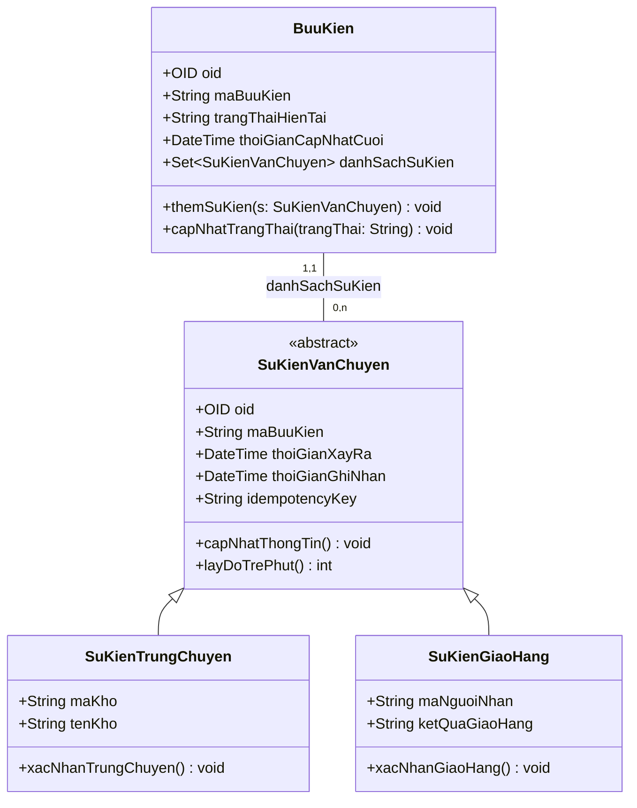

# CHƯƠNG 6 (PHẦN OODB): THIẾT KẾ CSDL HƯỚNG ĐỐI TƯỢNG VÀ TRUY VẤN OQL

Tài liệu này đặc tả mô hình Cơ sở dữ liệu Hướng đối tượng (OODB) theo chuẩn **ODMG 3.0** cho bài toán **Theo dõi vận chuyển và bàn giao bưu kiện (Đề tài 13)**, bám sát 100% sơ đồ lớp (UML Class Diagram) và dữ liệu thực nghiệm của nhóm.

---

## 1. Sơ đồ lớp hướng đối tượng (UML Class Diagram)

Mô hình gồm **4 lớp** thể hiện đầy đủ các đặc trưng hướng đối tượng: định danh đối tượng (`OID`), thuộc tính tập hợp (`Set<T>`), kế thừa – đa hình (`<<abstract>> SuKienVanChuyen` kế thừa bởi `SuKienTrungChuyen` và `SuKienGiaoHang`), và các phương thức hành vi (methods).



---

## 2. Đặc tả lớp bằng ngôn ngữ ODL (Object Definition Language - ODMG 3.0)

```odl
class BuuKien (extent BuuKien key maBuuKien) {
    attribute OID oid;
    attribute string maBuuKien;
    attribute string trangThaiHienTai;
    attribute timestamp thoiGianCapNhatCuoi;

    // Quan hệ tập hợp 1-N chứa các sự kiện vận chuyển của bưu kiện
    relationship set<SuKienVanChuyen> danhSachSuKien;

    // Các phương thức (Methods)
    void themSuKien(in SuKienVanChuyen s);
    void capNhatTrangThai(in string trangThai);
};

abstract class SuKienVanChuyen (extent SuKienVanChuyen key idempotencyKey) {
    attribute OID oid;
    attribute string maBuuKien;
    attribute timestamp thoiGianXayRa;
    attribute timestamp thoiGianGhiNhan;
    attribute string idempotencyKey;

    // Phương thức tính độ trễ ghi nhận (phút) = (thoiGianGhiNhan - thoiGianXayRa)
    void capNhatThongTin();
    long layDoTrePhut();
};

class SuKienTrungChuyen extends SuKienVanChuyen (extent SuKienTrungChuyen) {
    attribute string maKho;
    attribute string tenKho;

    void xacNhanTrungChuyen();
};

class SuKienGiaoHang extends SuKienVanChuyen (extent SuKienGiaoHang) {
    attribute string maNguoiNhan;
    attribute string ketQuaGiaoHang;

    void xacNhanGiaoHang();
};
```

---

## 3. Bộ 5 câu truy vấn OQL chuẩn hóa và ánh xạ sang SQL

### Câu 1: Duyệt thuộc tính tập hợp (Collection Navigation) lấy hành trình của bưu kiện `PK00000001`
- **Mục tiêu nghiệp vụ:** Đi từ đối tượng `BuuKien` và giải phẳng (unnest) trực tiếp tập hợp tham chiếu đối tượng `b.danhSachSuKien` để lấy toàn bộ lịch sử sự kiện của bưu kiện `"PK00000001"` mà không cần phép kết nối (`JOIN`) tường minh.
- **Truy vấn OQL (Chuẩn ODMG 3.0):**
```sql
SELECT e
FROM BuuKien b, b.danhSachSuKien e
WHERE b.maBuuKien = "PK00000001";
```
- **Ánh xạ tương đương trong CSDL quan hệ (PostgreSQL):**
```sql
SELECT e.*
FROM pa_a.buukien b
JOIN pa_a.sukientrangthai e ON b.ma_buu_kien = e.ma_buu_kien
WHERE b.ma_buu_kien = 'PK00000001'
ORDER BY e.thoi_gian_xay_ra ASC;
```

---

### Câu 2: Truy vấn chuyên biệt trên lớp con `SuKienGiaoHang`
- **Mục tiêu nghiệp vụ:** Chỉ truy vấn các đối tượng thuộc lớp con `SuKienGiaoHang` có kết quả giao hàng thành công (`"THANH_CONG"`).
- **Truy vấn OQL:**
```sql
SELECT g
FROM SuKienGiaoHang g
WHERE g.ketQuaGiaoHang = "THANH_CONG";
```
- **Ánh xạ tương đương trong CSDL quan hệ (PostgreSQL):**
```sql
SELECT e.*
FROM pa_a.sukientrangthai e
WHERE e.ma_trang_thai = 'GIAO_THANH_CONG';
```

---

### Câu 3: Gọi phương thức của đối tượng trong `WHERE` (Đa hình trên lớp cha `SuKienVanChuyen`)
- **Mục tiêu nghiệp vụ:** Tìm các sự kiện đến muộn (late-arriving events) trên toàn bộ cây kế thừa `SuKienVanChuyen` có độ trễ ghi nhận lớn hơn 30 phút thông qua phương thức `layDoTrePhut()`.
- **Truy vấn OQL:**
```sql
SELECT e
FROM SuKienVanChuyen e
WHERE e.layDoTrePhut() > 30;
```
- **Ánh xạ tương đương trong CSDL quan hệ (PostgreSQL):**
```sql
SELECT e.*,
       EXTRACT(EPOCH FROM (e.thoi_gian_ghi_nhan - e.thoi_gian_xay_ra)) / 60.0 AS do_tre_phut
FROM pa_a.sukientrangthai e
WHERE EXTRACT(EPOCH FROM (e.thoi_gian_ghi_nhan - e.thoi_gian_xay_ra)) / 60.0 > 30;
```

---

### Câu 4: Lấy các bưu kiện có sự kiện giao hàng thất bại (`EXISTS` & Ép kiểu tĩnh lớp con)
- **Mục tiêu nghiệp vụ:** Tìm các đối tượng `BuuKien` mà trong tập lịch sử sự kiện `danhSachSuKien` có ít nhất một sự kiện thuộc lớp con `SuKienGiaoHang` mang trạng thái thất bại (`"THAT_BAI"`).
- **Truy vấn OQL (Chuẩn kiểm tra kiểu tĩnh ODMG 3.0):**
```sql
SELECT b
FROM BuuKien b
WHERE EXISTS g IN b.danhSachSuKien : (
    g IN SuKienGiaoHang AND ((SuKienGiaoHang) g).ketQuaGiaoHang = "THAT_BAI"
);
```
- **Ánh xạ tương đương trong CSDL quan hệ (PostgreSQL):**
```sql
SELECT b.*
FROM pa_a.buukien b
WHERE EXISTS (
    SELECT 1
    FROM pa_a.sukientrangthai g
    WHERE g.ma_buu_kien = b.ma_buu_kien
      AND g.ma_trang_thai = 'GIAO_THAT_BAI'
);
```

---

### Câu 5: Thống kê gom nhóm (`GROUP BY` & `struct`) trên lớp con `SuKienTrungChuyen`
- **Mục tiêu nghiệp vụ:** Thống kê tổng số lượt sự kiện trung chuyển và độ trễ ghi nhận trung bình theo từng kho trung chuyển (`maKho`, `tenKho`), phủ kín 100% các lớp trong sơ đồ thiết kế.
- **Truy vấn OQL:**
```sql
SELECT struct(
    maKho: maKho,
    tenKho: tenKho,
    soLuotTrungChuyen: COUNT(partition),
    doTreTrungBinhPhut: AVG(SELECT p.t.layDoTrePhut() FROM partition p)
)
FROM SuKienTrungChuyen t
GROUP BY maKho: t.maKho, tenKho: t.tenKho;
```
- **Ánh xạ tương đương trong CSDL quan hệ (PostgreSQL):**
```sql
SELECT d.ma_diem_giao_nhan AS ma_kho,
       d.ten_diem AS ten_kho,
       COUNT(e.ma_su_kien) AS so_luot_trung_chuyen,
       ROUND(AVG(EXTRACT(EPOCH FROM (e.thoi_gian_ghi_nhan - e.thoi_gian_xay_ra)) / 60.0), 2) AS do_tre_trung_binh_phut
FROM pa_a.sukientrangthai e
JOIN pa_a.khotrungchuyen k ON e.ma_diem = k.ma_diem_giao_nhan
JOIN pa_a.diemgiaonhan d ON k.ma_diem_giao_nhan = d.ma_diem_giao_nhan
GROUP BY d.ma_diem_giao_nhan, d.ten_diem;
```
